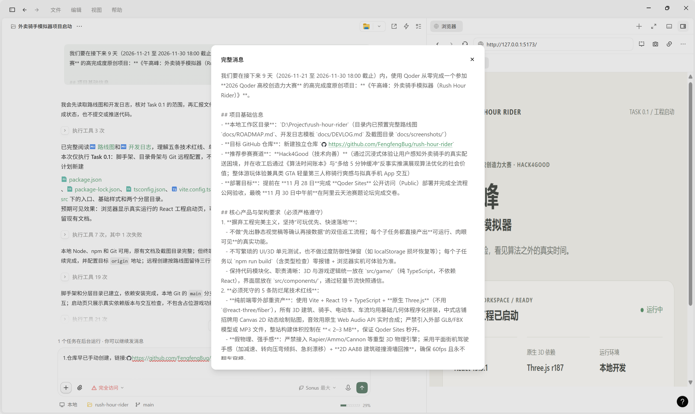
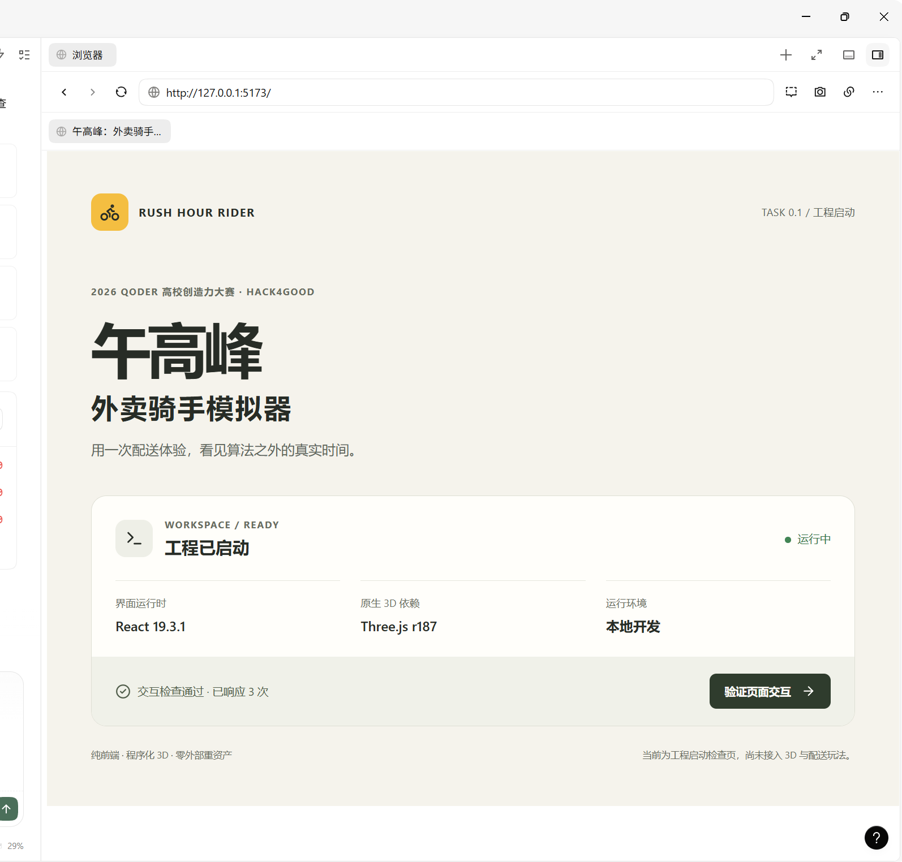

# 午高峰：外卖骑手模拟器 · 开发过程记录（DEVLOG）

用于按时间正序归档 2026 Qoder 高校创造力大赛全周期开发证据，每次完成子任务并经用户附截图确认后追加记录，形成完整、真实的 Qoder 协作开发与实机演进档案。

> **截图归档约定**：
> - 存放目录：`docs/screenshots/`
> - 命名格式：`YYYY-MM-DD-task-XX-01.png`（建议每项子任务保留 1 张 Qoder 协作开发截图 + 1 张浏览器实机画面截图）

---

## 开发记录

<!-- 每次完成子任务，用户发送截图并指令“记录这条”后，按以下模板追加：

### YYYY-MM-DD · Task X.Y <任务名称>

简要说明：<一句话概括本任务完成内容、关键交互与 build/实机验收结果>；提交 `<short-hash>`。

-->

### 2026-11-21 · Task 0.1 工程脚手架、目录结构与 GitHub 仓库绑定

简要说明：完成 Vite + React 19 + TypeScript 工程，安装原生 Three.js、类型声明与 lucide-react，建立 `src/game/` 和 `src/components/` 分层目录；启动页显示实际依赖版本并支持 React 交互检查。GitHub 目标仓库由用户手动创建，已核验并绑定 `origin`，本次按用户“记录这条任务”确认归档两张原始截图。

验收结果：`npm run build`（`tsc --noEmit` + Vite）通过；开发与生产预览均可运行，连续点击和刷新重置正常，1440/390/320px 视口无横向溢出，控制台无 error/warn、无外部素材请求；当前脚手架生产产物约 230 KB，尚未接入 3D 与配送玩法。

**开发过程：Qoder 需求约束、任务拆解与工程启动同屏。**

**浏览器实机：工程启动页显示实际 React/Three.js 版本，交互检查已响应 3 次。**

### 2026-11-21 · Task 0.2 Three.js 渲染宿主与最小 3D 光照场景

简要说明：建立独立纯 TypeScript `GameEngine` 和 React 挂载容器，呈现暖色天空、地面、持续旋转的黄色参考方块及方向光实时阴影；通过约 10Hz 快照展示实际帧率、绘制调用、视口和像素比，不由 React 驱动逐帧渲染。

验收结果：`npm run build` 通过，当前产物约 764 KB（gzip 约 205 KB），保留单 chunk 超过 500 KB 的构建提示，未调高警告阈值。独立 Chrome 验证桌面/窄屏/横屏布局、DPR 3 限制为 2、StrictMode 单画布，以及三轮引擎销毁重建后几何体/材质/阴影与 WebGL 上下文释放、帧循环及监听器不累积；开发和生产页面控制台无 error/warn、无外部素材请求。

**用户确认截图：Qoder 改动与验收记录、旋转参考方块和实时阴影同屏；该设备实测面板显示 165 FPS、3 次绘制调用、1004 × 772 视口及 1.50× 像素比。**

