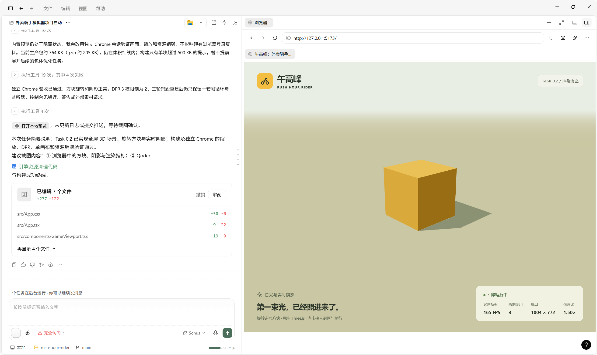
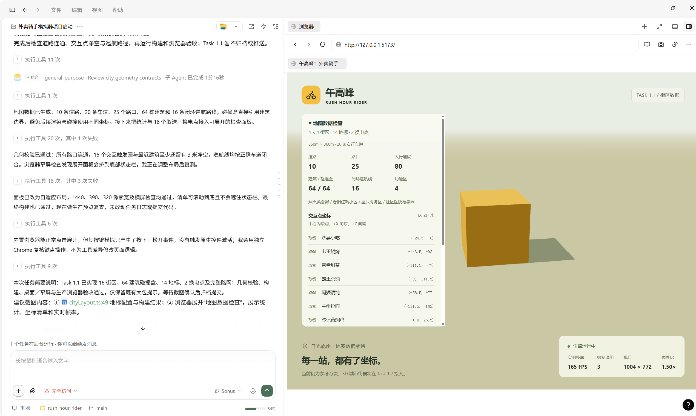
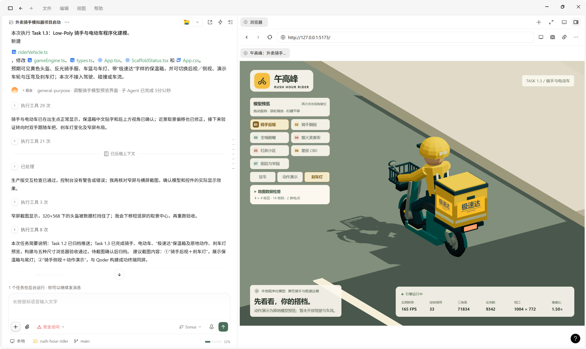
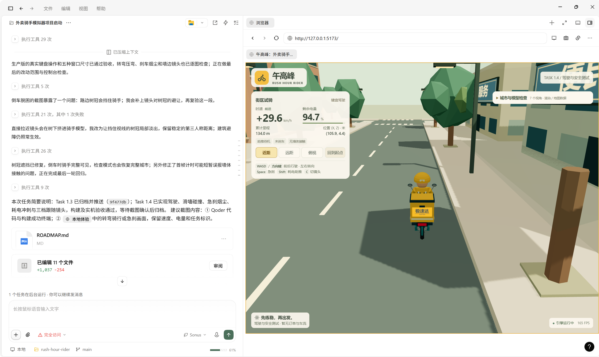
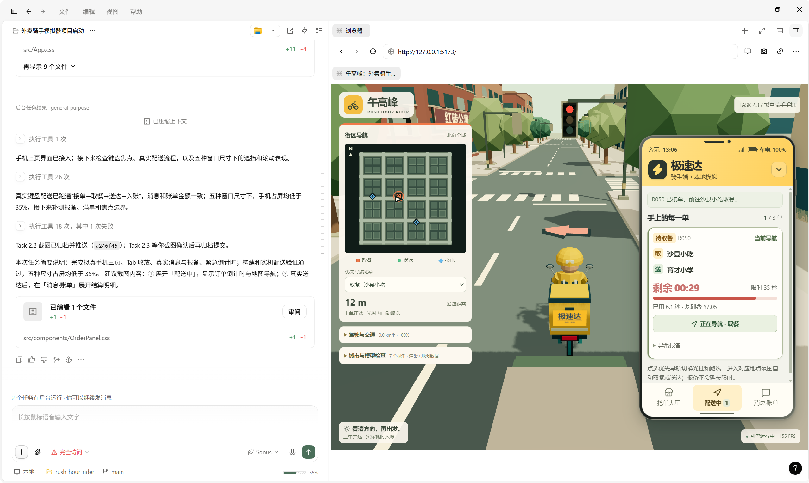
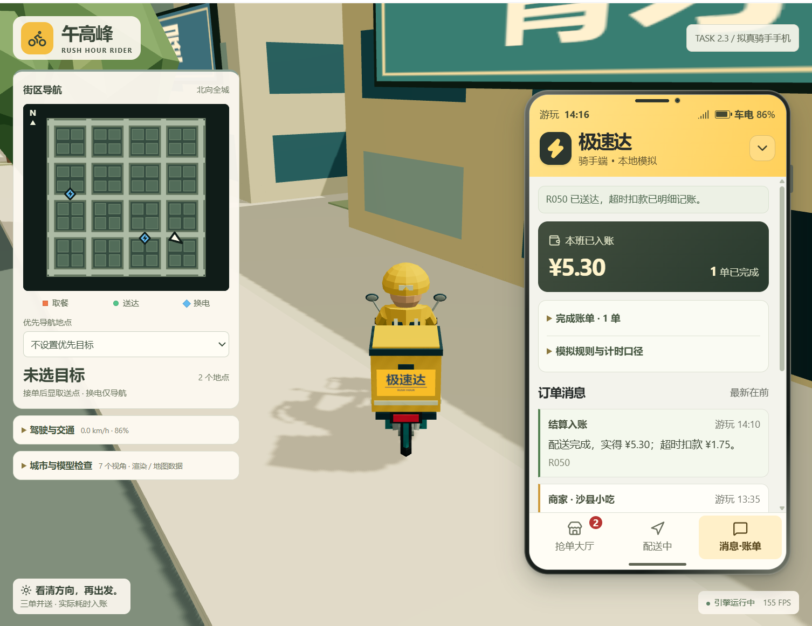

# 午高峰：外卖骑手模拟器 · 开发过程记录（DEVLOG）

用于按时间正序归档 2026 Qoder 高校创造力大赛全周期开发证据，每次完成子任务并经用户附截图确认后追加记录，形成完整、真实的 Qoder 协作开发与实机演进档案。

> **截图归档约定**：
> - 存放目录：`docs/screenshots/`
> - 命名格式：`YYYY-MM-DD-task-XX-01.png`（建议每项子任务保留 1 张 Qoder 协作开发截图 + 1 张浏览器实机画面截图）

---

## 开发记录

<!-- 每次完成子任务，用户发送截图并指令“记录这条”后，按以下模板追加：

### YYYY-MM-DD · Task X.Y <任务名称>

简要说明：<一句话概括本任务完成内容、关键交互与 build/实机验收结果>；提交 `<short-hash>`。

-->

### 2026-11-21 · Task 0.1 工程脚手架、目录结构与 GitHub 仓库绑定

简要说明：完成 Vite + React 19 + TypeScript 工程，安装原生 Three.js、类型声明与 lucide-react，建立 `src/game/` 和 `src/components/` 分层目录；启动页显示实际依赖版本并支持 React 交互检查。GitHub 目标仓库由用户手动创建，已核验并绑定 `origin`，本次按用户“记录这条任务”确认归档两张原始截图。

验收结果：`npm run build`（`tsc --noEmit` + Vite）通过；开发与生产预览均可运行，连续点击和刷新重置正常，1440/390/320px 视口无横向溢出，控制台无 error/warn、无外部素材请求；当前脚手架生产产物约 230 KB，尚未接入 3D 与配送玩法。

**开发过程：Qoder 需求约束、任务拆解与工程启动同屏。**

**浏览器实机：工程启动页显示实际 React/Three.js 版本，交互检查已响应 3 次。**

### 2026-11-21 · Task 0.2 Three.js 渲染宿主与最小 3D 光照场景

简要说明：建立独立纯 TypeScript `GameEngine` 和 React 挂载容器，呈现暖色天空、地面、持续旋转的黄色参考方块及方向光实时阴影；通过约 10Hz 快照展示实际帧率、绘制调用、视口和像素比，不由 React 驱动逐帧渲染。

验收结果：`npm run build` 通过，当前产物约 764 KB（gzip 约 205 KB），保留单 chunk 超过 500 KB 的构建提示，未调高警告阈值。独立 Chrome 验证桌面/窄屏/横屏布局、DPR 3 限制为 2、StrictMode 单画布，以及三轮引擎销毁重建后几何体/材质/阴影与 WebGL 上下文释放、帧循环及监听器不累积；开发和生产页面控制台无 error/warn、无外部素材请求。

**用户确认截图：Qoder 改动与验收记录、旋转参考方块和实时阴影同屏；该设备实测面板显示 165 FPS、3 次绘制调用、1004 × 772 视口及 1.50× 像素比。**

### 2026-11-21 · Task 1.1 4×4 微缩中国街区地图数据与 2D AABB 碰撞盒

简要说明：建立确定性的 360m×360m 城市坐标数据，包含 16 个街区、4 个功能区、10 条道路与 20 条右行车道、25 个路口、80 段人行道、64 栋建筑及共享 AABB、7 家商家与 7 个送达地标、2 个换电点和 16 条闭环巡航路线；现有页面增加直接读取真实数据的统计与坐标清单，尚未提前制作 3D 街景。

验收结果：建筑无重叠或堵路，25 个路口全部连通，16 个交互触发圆距建筑的最小额外净空为 3 米，巡航路线沿正确车道闭合，重复生成结果一致。`npm run build` 通过，当前产物约 774 KB（gzip 约 208 KB），保留既有单 chunk 超过 500 KB 提示；1440/390/320px 与横屏的展开、收起、滚动到底及单画布检查通过，独立 Chrome 生产预览确认原生 Enter/Space 操作正常，控制台无 error/warn、无外部素材请求。

**用户确认截图：Qoder 几何与浏览器验收过程、地图数据检查面板、旋转参考方块和实时状态同屏；面板显示 64/64 建筑与碰撞盒、16 条巡航线及 4 个功能区，该设备实测为 165 FPS。**

### 2026-11-21 · Task 1.2 Low-Poly 城市街景、中式动态招牌与合批渲染

简要说明：从同一份城市数据生成沥青道路、斑马线、人行道、四区差异化建筑、行道树、路灯与换电柜；本地 Canvas 图集绘制 66 块中文招牌，重复结构使用 8 个 InstancedMesh 批次，招牌合并为一个网格。新增全城及四分区视角，支持拖动旋转、滚轮缩放、右键平移和再次点击复位；尚未接入骑手、驾驶或车流。

验收结果：64 栋建筑主体 XZ 边界与源 AABB 完全一致，9342 个实例、67480 个三角面，稳定帧共 9 次绘制调用；树灯避开 16 个交互入口，三轮创建/销毁的资源、帧循环、监听器和 WebGL 上下文释放检查通过。`npm run build` 通过，产物约 822 KB（gzip 约 222 KB），保留单 chunk 超过 500 KB 提示；生产版五视角、鼠标操作、原生 Enter/Space、1440/1024/390/320px 与横屏布局均通过，控制台无 error/warn、无外部素材请求。

**用户确认截图：Qoder 开发过程与全城俯瞰同屏；该设备面板显示 165 FPS、9 次绘制调用、67480 三角面与 9342 实例，不代表所有设备的帧率。**

**用户确认截图：烟火美食街近景，程序化中文灯箱招牌、彩色屋顶、斑马线、树木与路灯清晰可见。**

### 2026-11-21 · Task 1.3 Low-Poly 骑手与电动车程序化建模

简要说明：用基础几何体拼装黄色头盔、反光服、握把骑手、电动车车篮、前后灯与方形保温箱，三面本地 Canvas 贴字“极速达”；统一地面原点与局部 +Z 前向，放置于主干道出生点朝东。按材质和运动层级合并网格，提供车轮滚动、转向握把与前臂联动、压弯、刹车灯更新接口；新增后视/侧视及驻车/原地动作/刹车灯预览，尚未接入驾驶或车流。

验收结果：模型轮胎接地、出生朝向、双手随车把转向、本地贴图、三轮资源释放及引擎销毁检查通过；修正高倍正交近景偏移和 320×568 头盔遮挡。`npm run build` 通过，产物约 834 KB（gzip 约 226 KB），保留单 chunk 超过 500 KB 提示；生产版七视角、鼠标旋转/缩放/平移/复位、原地动作/停驻/刹车灯、原生 Enter/Space、五种视口与 DPR 上限检查通过，控制台无 error/warn、无失败或外部素材请求。

**用户确认截图：Qoder 开发与验收过程、骑手后视和点亮的刹车灯同屏；该设备显示 165 FPS、33 次绘制调用、71834 三角面，不代表所有设备的帧率。**

**用户确认截图：骑手侧视与原地动作演示；车篮、握把姿态及保温箱可辨，动态阴影刷新时该设备面板显示 62 次绘制调用、118594 三角面。**

### 2026-11-21 · Task 1.4 街机驾驶手感、滑墙碰撞与第三人称弹簧相机

简要说明：接入 WASD/方向键加速、倒车与转向压弯，Space 急刹尾灯与实例烟尘，Shift 耗电冲刺；使用实际位移累计里程和电耗，正常/冲刺最高时速分别为 36/54 km/h。建筑膨胀 AABB 分轴扫掠实现滑墙减速与倒车脱困，地图边界限制生效；第三人称弹簧相机支持 C 循环近距/远距/俯视，建筑避障和遮挡树冠局部淡出避免丢失骑手视野。新增驾驶数据与操作面板，检查模式停车、失焦清键、回到起点恢复电量和里程；未提前接入车流、订单或手机。

验收结果：64 栋建筑四个方向共 256 面高速碰撞、5 万步连续轨迹和 30/60/144Hz 一致性轻量检查通过；生产版真实键盘验证加减速、倒车、冲刺、急刹、滑墙退出、边界、C 镜头及失焦停车，七检查视角、五种视口、原生 Enter/Space 与 DPR 上限均通过。已修复首帧负时间差误报接触；三轮引擎销毁的资源、监听器、帧循环和 WebGL 上下文释放通过。`npm run build` 通过，产物约 852 KB（gzip 约 232 KB），保留既有单 chunk 超过 500 KB 提示；浏览器控制台无 error/warn、无外部素材或失败请求。

**用户确认截图：Qoder 实现与验收过程、真实第三人称街道骑行同屏；面板显示时速 +29.6 km/h、电量 94.7%、累计里程 134.0m、位置 (105.9, 4.4)，该设备显示 165 FPS，不代表所有设备的帧率。**

### 2026-11-21 · Task 1.5 动态红绿灯、巡航方块车流与鸣笛/违章判定

简要说明：9 个主要路口接入错峰红黄绿与全红清空相位，12 辆小汽车和 4 辆公交沿 8 条确定性右行闭环巡航、平滑右转、红灯排队并避让前方骑手；交通模型使用 5 个实例批次。H 触发两圈轻微鸣笛波纹，车辆剐蹭安全回推减速，越过红灯停止线产出真实事件回调；约 10Hz 快照展示附近信号倒计时、车流和最近三条安全记录。检查模式冻结车流，回到起点重置交通时钟与记录；尚未接入导航、订单或音效。

验收结果：30/60/144Hz 五分钟交通模拟无车辆重叠、穿楼或越界，车头在停止线前 0.4m 停稳并恢复通行；864 个信号越线用例、72 个有向碰撞用例和 3844 个安全回推用例通过。生产版真实键盘验证鸣笛及重复键、红灯排队放行、碰撞减速与倒车、闯灯记录、镜头切换、重置和检查冻结；五种视口、原生 Enter/Space、DPR 上限与三轮 71 项资源释放检查通过。`npm run build` 通过，产物约 873 KB（gzip 约 238 KB），保留既有单 chunk 超过 500 KB 提示；浏览器无 error/warn、无外部素材或失败请求。

**用户确认截图：Qoder 实现与验收过程、路口红灯和街道车流同屏；骑行累计 222.4m、电量 94.4%，真实闯红灯计数为 1，该设备显示 165 FPS，不代表所有设备的帧率。**

**用户确认截图：绿灯与展开的安全记录，显示交通时钟 364.1s、216.2s 时在 (73.3, 3.0) 触发的闯灯事件；原图保留近处 NPC 车辆部分遮挡骑手的实机状态，该镜头遮挡问题尚未处理。**

### 2026-11-21 · Task 2.1 3D 取送光柱指引与 GTA 风 2D 实时导航小地图

简要说明：从真实路侧接入点生成 7 个取餐、7 个送达和 2 个换电导航地点，使用 5 个实例批次绘制三色半透明光柱、地面圈和差异化浮标；优先目标配有动态名称与平滑方向箭头。左上角北向 Canvas 小地图复用静态城市缓存，直接接收引擎逐帧位置与朝向，React 快照仍约 10Hz；支持地点选择、沿道路虚线与实际距离、到达/离开、清除路线和重置。驾驶与城市检查折叠保留；本阶段明确标注自由导航，尚未接入订单、取送状态机或计费。

验收结果：918704 条路线及 3207100 段线段检查通过，修正换电点冗余折返，无穿越膨胀建筑碰撞盒、无缺失路线；101 个导航状态断言通过。生产版使用真实键盘从出生点骑到陈记黄焖鸡，验证 16 地点选择、到达与离开、清除、重置、驾驶与车流回归；五种视口、DPR 上限、原生键盘控件和三轮 89 项自有资源释放检查通过，修复 320px 面板遮挡头盔。`npm run build` 通过，产物约 930 KB（gzip 约 255 KB），保留既有单 chunk 超过 500 KB 提示；正常运行控制台无 error/warn、无外部素材或失败请求。

**用户确认截图：Qoder 开发与验收记录、北向小地图、绿色方向箭头和街道车流同屏；优先目标为幸福里小区，沿路距离 98m、电量 100%，该设备显示 165 FPS。原图保留近处车辆进入镜头的实机状态。**

**用户确认截图：骑手实际到达幸福里小区路侧点，绿色范围圈和房屋浮标可见，小地图与标签同步显示已到达、2.5m 范围内，电量为 95%；这是自由导航到达，不是完成配送订单。**

### 2026-11-21 · Task 2.2 订单调度引擎、3 单并发与分段耗时记账

简要说明：纯 TypeScript 订单状态机开局生成三单，后续按 12–20 秒有效游玩时间刷新，最多同时持有三单；接单锁定当前位置的直线限时估算，真实进入路侧范围自动取餐、切换送达导航并按整数分结算基础费、准时奖与超时扣款。每单独立记录行驶、等红灯和普通停车，尚未实现的卡餐/末端/突发保持零；账本与交通共用游玩时钟，检查与后台暂停，多单时间不冒充班次时长。新增可折叠订单操作和完整账单，当前仅展示激活订单与换电目标；尚未制作拟真手机、HUD 或现实事件。

验收结果：54 个独立模型用例、737958 次断言、55087 次账本检查与 216 次等红灯几何断言通过，覆盖 6 小时派单、1 小时 141 单配送和 30/60/144Hz 账本守恒；修复连续穿过取送范围与派单替换槽位边界。生产版真实键盘完整配送实测 35.458 秒、结算 ¥5.28（仅该次测试），三单上限、导航切换、暂停恢复、重置、五视口与原生控件通过；三轮每轮 89 项自有资源释放检查通过。`npm run build` 通过，产物约 951 KB（gzip 约 261 KB），保留既有单 chunk 超过 500 KB 提示；正常浏览器控制台无 error/warn、无外部素材或失败请求。

**用户确认截图：Qoder 验收过程与三单在途同屏，持有 3/3 时新单按钮禁用；优先导航指向蜜雪甜茶，沿路距离 180m，多单真实倒计时可见。**

**用户确认截图：R030 送达后提示超时扣款已明细记账，持有回到 0/3、累计收入 ¥6.51，取送目标清除，仅保留两个换电地点；该原图未展开完成账单，因此不将其描述为分段明细截图。**

### 2026-11-21 · Task 2.3 右下角拟真骑手手机 App

简要说明：新增黄黑圆角手机机身与抢单大厅、配送中、消息·账单三个真实业务页；收起时显示最急订单、当前取送目的地和未读新单，支持画布 Tab 收放、Esc 关闭与原生控件 Tab/Shift+Tab 遍历。订单卡联动光柱和地图，低于 30 秒红色轻脉冲提醒，支持优先导航和去重异常报备；报备只保存玩家选择，不伪造耗时或减免扣款。消息仅由实际接单、取餐、剩余 15 秒提醒、报备和结算触发，钱包保留完整真实账本；顺路标记采用明确标注的直线增量估算。手机时钟为游玩时间、电量为真实车电，尚未制作 Task 2.4 HUD、班次时钟或看手机风险效果。

验收结果：`npm run build` 含类型检查通过，生产资产约 985 KB（gzip 约 270 KB），保留既有单 chunk 超过 500 KB 提示。2000 步模型检查覆盖消息阈值、报备去重与计费不变、快照隔离和重置；另验证取餐后顺路估算正例。真实 Chrome 键盘完成 R002 接单取送，实际耗时 34.480 秒、实得 ¥5.33（仅该次测试），消息与账本一致。满单、未读新单、优先导航、原生焦点、检查/后台暂停、重置、减弱动画偏好及驾驶回归通过；五种视口下展开手机占屏约 15.3%–34.0%，无横向溢出，额外检查 601×501 断点与六尺寸收起态头盔无遮挡。正常浏览器控制台无 error/warn、无外部素材或失败请求。

**用户确认截图：Qoder 开发验收过程与手机「配送中」同屏，R050 沙县小吃送往育才小学，持有 1/3，剩余 00:29 呈红色警示、基础费 ¥7.05，取餐导航沿路 12m。**

**用户确认截图：R050 已送达，手机「消息·账单」显示本班实得 ¥5.30、完成 1 单，结算消息明确超时扣款 ¥1.75，商家交接消息和新单徽章可见；完成账单折叠，原图不作为展开分段明细的证据。**

### 2026-11-21 · Task 2.4 顶部 HUD 状态栏与“低头看手机”风险联动

简要说明：因 Qoder 额度耗尽，自 Task 2.4 起经批准临时切换 Antigravity 继续按原路线图与留痕规范推进。新增顶部紧凑 HUD（`11:30 → 13:30` 模拟午高峰时钟与 3.5 分钟倒计时条、今日收入、完成与在途单数、真实准时率、电动车电量条、骑手体力条、视角循环按钮及本地持久静音开关）与 `13:30` 收工提示条；同步骑手手机状态栏时钟为午高峰时间。接入“低头看手机”风险联动：停车（速度 < 0.8 m/s）展开手机视野清晰，骑行中展开手机触发 3D 视口边缘径向虚化与红边晕影、克制镜头轻晃、转向灵敏度下降及车辆剐蹭风险半径增大，并弹出红色警示条“边骑边看手机，注意前方路况！”，刹停或收起手机立即恢复清晰；至此 Stage 2 完整垂直切片可玩。

验收结果：`npm run build`（`tsc --noEmit` + Vite）通过，生产产物约 1005 KB（gzip 约 275 KB），保留既有单 chunk 超过 500 KB 提示。浏览器实机验证顶部 HUD 全项数值、视角与静音切换、停车看手机清晰安全、加速骑行展开手机触发边缘虚化/红边警示与电量/体力真实变化、刹停立即恢复清晰，控制台无报错、无失败请求。

**用户确认截图：实机游玩至午高峰 `13:26`（剩 `00:07`），已完成 2 单、在途 1/3、今日收入 ¥13.42、准时率 50%、电量 58%、体力 98%；以 +36.0 km/h 骑向老王烧烤（R013，沿路 62 m）时展开手机，画面边缘出现红晕虚化与顶部红色警示“边骑边看手机，注意前方路况！”，HUD 与手机文字保持清晰，该设备显示 165 FPS，不代表所有设备的帧率。**

