# 午高峰：外卖骑手模拟器 · 开发过程记录（DEVLOG）

用于按时间正序归档 2026 Qoder 高校创造力大赛全周期开发证据，每次完成子任务并经用户附截图确认后追加记录，形成完整、真实的 Qoder 协作开发与实机演进档案。

> **截图归档约定**：
> - 存放目录：`docs/screenshots/`
> - 命名格式：`YYYY-MM-DD-task-XX-01.png`（建议每项子任务保留 1 张 Qoder 协作开发截图 + 1 张浏览器实机画面截图）

---

## 开发记录

<!-- 每次完成子任务，用户发送截图并指令“记录这条”后，按以下模板追加：

### YYYY-MM-DD · Task X.Y <任务名称>

简要说明：<一句话概括本任务完成内容、关键交互与 build/实机验收结果>；提交 `<short-hash>`。

-->

### 2026-11-21 · Task 0.1 工程脚手架、目录结构与 GitHub 仓库绑定

简要说明：完成 Vite + React 19 + TypeScript 工程，安装原生 Three.js、类型声明与 lucide-react，建立 `src/game/` 和 `src/components/` 分层目录；启动页显示实际依赖版本并支持 React 交互检查。GitHub 目标仓库由用户手动创建，已核验并绑定 `origin`，本次按用户“记录这条任务”确认归档两张原始截图。

验收结果：`npm run build`（`tsc --noEmit` + Vite）通过；开发与生产预览均可运行，连续点击和刷新重置正常，1440/390/320px 视口无横向溢出，控制台无 error/warn、无外部素材请求；当前脚手架生产产物约 230 KB，尚未接入 3D 与配送玩法。

**开发过程：Qoder 需求约束、任务拆解与工程启动同屏。**

**浏览器实机：工程启动页显示实际 React/Three.js 版本，交互检查已响应 3 次。**

### 2026-11-21 · Task 0.2 Three.js 渲染宿主与最小 3D 光照场景

简要说明：建立独立纯 TypeScript `GameEngine` 和 React 挂载容器，呈现暖色天空、地面、持续旋转的黄色参考方块及方向光实时阴影；通过约 10Hz 快照展示实际帧率、绘制调用、视口和像素比，不由 React 驱动逐帧渲染。

验收结果：`npm run build` 通过，当前产物约 764 KB（gzip 约 205 KB），保留单 chunk 超过 500 KB 的构建提示，未调高警告阈值。独立 Chrome 验证桌面/窄屏/横屏布局、DPR 3 限制为 2、StrictMode 单画布，以及三轮引擎销毁重建后几何体/材质/阴影与 WebGL 上下文释放、帧循环及监听器不累积；开发和生产页面控制台无 error/warn、无外部素材请求。

**用户确认截图：Qoder 改动与验收记录、旋转参考方块和实时阴影同屏；该设备实测面板显示 165 FPS、3 次绘制调用、1004 × 772 视口及 1.50× 像素比。**

### 2026-11-21 · Task 1.1 4×4 微缩中国街区地图数据与 2D AABB 碰撞盒

简要说明：建立确定性的 360m×360m 城市坐标数据，包含 16 个街区、4 个功能区、10 条道路与 20 条右行车道、25 个路口、80 段人行道、64 栋建筑及共享 AABB、7 家商家与 7 个送达地标、2 个换电点和 16 条闭环巡航路线；现有页面增加直接读取真实数据的统计与坐标清单，尚未提前制作 3D 街景。

验收结果：建筑无重叠或堵路，25 个路口全部连通，16 个交互触发圆距建筑的最小额外净空为 3 米，巡航路线沿正确车道闭合，重复生成结果一致。`npm run build` 通过，当前产物约 774 KB（gzip 约 208 KB），保留既有单 chunk 超过 500 KB 提示；1440/390/320px 与横屏的展开、收起、滚动到底及单画布检查通过，独立 Chrome 生产预览确认原生 Enter/Space 操作正常，控制台无 error/warn、无外部素材请求。

**用户确认截图：Qoder 几何与浏览器验收过程、地图数据检查面板、旋转参考方块和实时状态同屏；面板显示 64/64 建筑与碰撞盒、16 条巡航线及 4 个功能区，该设备实测为 165 FPS。**

### 2026-11-21 · Task 1.2 Low-Poly 城市街景、中式动态招牌与合批渲染

简要说明：从同一份城市数据生成沥青道路、斑马线、人行道、四区差异化建筑、行道树、路灯与换电柜；本地 Canvas 图集绘制 66 块中文招牌，重复结构使用 8 个 InstancedMesh 批次，招牌合并为一个网格。新增全城及四分区视角，支持拖动旋转、滚轮缩放、右键平移和再次点击复位；尚未接入骑手、驾驶或车流。

验收结果：64 栋建筑主体 XZ 边界与源 AABB 完全一致，9342 个实例、67480 个三角面，稳定帧共 9 次绘制调用；树灯避开 16 个交互入口，三轮创建/销毁的资源、帧循环、监听器和 WebGL 上下文释放检查通过。`npm run build` 通过，产物约 822 KB（gzip 约 222 KB），保留单 chunk 超过 500 KB 提示；生产版五视角、鼠标操作、原生 Enter/Space、1440/1024/390/320px 与横屏布局均通过，控制台无 error/warn、无外部素材请求。

**用户确认截图：Qoder 开发过程与全城俯瞰同屏；该设备面板显示 165 FPS、9 次绘制调用、67480 三角面与 9342 实例，不代表所有设备的帧率。**

**用户确认截图：烟火美食街近景，程序化中文灯箱招牌、彩色屋顶、斑马线、树木与路灯清晰可见。**

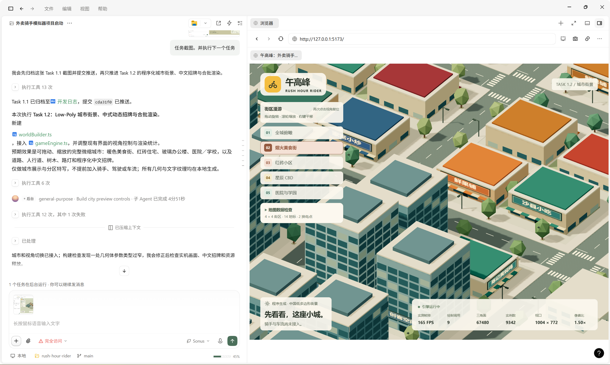

### 2026-11-21 · Task 1.3 Low-Poly 骑手与电动车程序化建模

简要说明：用基础几何体拼装黄色头盔、反光服、握把骑手、电动车车篮、前后灯与方形保温箱，三面本地 Canvas 贴字“极速达”；统一地面原点与局部 +Z 前向，放置于主干道出生点朝东。按材质和运动层级合并网格，提供车轮滚动、转向握把与前臂联动、压弯、刹车灯更新接口；新增后视/侧视及驻车/原地动作/刹车灯预览，尚未接入驾驶或车流。

验收结果：模型轮胎接地、出生朝向、双手随车把转向、本地贴图、三轮资源释放及引擎销毁检查通过；修正高倍正交近景偏移和 320×568 头盔遮挡。`npm run build` 通过，产物约 834 KB（gzip 约 226 KB），保留单 chunk 超过 500 KB 提示；生产版七视角、鼠标旋转/缩放/平移/复位、原地动作/停驻/刹车灯、原生 Enter/Space、五种视口与 DPR 上限检查通过，控制台无 error/warn、无失败或外部素材请求。

**用户确认截图：Qoder 开发与验收过程、骑手后视和点亮的刹车灯同屏；该设备显示 165 FPS、33 次绘制调用、71834 三角面，不代表所有设备的帧率。**

**用户确认截图：骑手侧视与原地动作演示；车篮、握把姿态及保温箱可辨，动态阴影刷新时该设备面板显示 62 次绘制调用、118594 三角面。**

### 2026-11-21 · Task 1.4 街机驾驶手感、滑墙碰撞与第三人称弹簧相机

简要说明：接入 WASD/方向键加速、倒车与转向压弯，Space 急刹尾灯与实例烟尘，Shift 耗电冲刺；使用实际位移累计里程和电耗，正常/冲刺最高时速分别为 36/54 km/h。建筑膨胀 AABB 分轴扫掠实现滑墙减速与倒车脱困，地图边界限制生效；第三人称弹簧相机支持 C 循环近距/远距/俯视，建筑避障和遮挡树冠局部淡出避免丢失骑手视野。新增驾驶数据与操作面板，检查模式停车、失焦清键、回到起点恢复电量和里程；未提前接入车流、订单或手机。

验收结果：64 栋建筑四个方向共 256 面高速碰撞、5 万步连续轨迹和 30/60/144Hz 一致性轻量检查通过；生产版真实键盘验证加减速、倒车、冲刺、急刹、滑墙退出、边界、C 镜头及失焦停车，七检查视角、五种视口、原生 Enter/Space 与 DPR 上限均通过。已修复首帧负时间差误报接触；三轮引擎销毁的资源、监听器、帧循环和 WebGL 上下文释放通过。`npm run build` 通过，产物约 852 KB（gzip 约 232 KB），保留既有单 chunk 超过 500 KB 提示；浏览器控制台无 error/warn、无外部素材或失败请求。

**用户确认截图：Qoder 实现与验收过程、真实第三人称街道骑行同屏；面板显示时速 +29.6 km/h、电量 94.7%、累计里程 134.0m、位置 (105.9, 4.4)，该设备显示 165 FPS，不代表所有设备的帧率。**

### 2026-11-21 · Task 1.5 动态红绿灯、巡航方块车流与鸣笛/违章判定

简要说明：9 个主要路口接入错峰红黄绿与全红清空相位，12 辆小汽车和 4 辆公交沿 8 条确定性右行闭环巡航、平滑右转、红灯排队并避让前方骑手；交通模型使用 5 个实例批次。H 触发两圈轻微鸣笛波纹，车辆剐蹭安全回推减速，越过红灯停止线产出真实事件回调；约 10Hz 快照展示附近信号倒计时、车流和最近三条安全记录。检查模式冻结车流，回到起点重置交通时钟与记录；尚未接入导航、订单或音效。

验收结果：30/60/144Hz 五分钟交通模拟无车辆重叠、穿楼或越界，车头在停止线前 0.4m 停稳并恢复通行；864 个信号越线用例、72 个有向碰撞用例和 3844 个安全回推用例通过。生产版真实键盘验证鸣笛及重复键、红灯排队放行、碰撞减速与倒车、闯灯记录、镜头切换、重置和检查冻结；五种视口、原生 Enter/Space、DPR 上限与三轮 71 项资源释放检查通过。`npm run build` 通过，产物约 873 KB（gzip 约 238 KB），保留既有单 chunk 超过 500 KB 提示；浏览器无 error/warn、无外部素材或失败请求。

**用户确认截图：Qoder 实现与验收过程、路口红灯和街道车流同屏；骑行累计 222.4m、电量 94.4%，真实闯红灯计数为 1，该设备显示 165 FPS，不代表所有设备的帧率。**

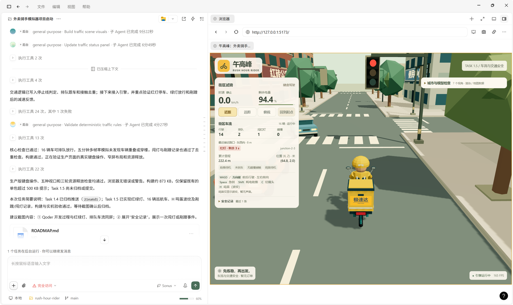

**用户确认截图：绿灯与展开的安全记录，显示交通时钟 364.1s、216.2s 时在 (73.3, 3.0) 触发的闯灯事件；原图保留近处 NPC 车辆部分遮挡骑手的实机状态，该镜头遮挡问题尚未处理。**

### 2026-11-21 · Task 2.1 3D 取送光柱指引与 GTA 风 2D 实时导航小地图

简要说明：从真实路侧接入点生成 7 个取餐、7 个送达和 2 个换电导航地点，使用 5 个实例批次绘制三色半透明光柱、地面圈和差异化浮标；优先目标配有动态名称与平滑方向箭头。左上角北向 Canvas 小地图复用静态城市缓存，直接接收引擎逐帧位置与朝向，React 快照仍约 10Hz；支持地点选择、沿道路虚线与实际距离、到达/离开、清除路线和重置。驾驶与城市检查折叠保留；本阶段明确标注自由导航，尚未接入订单、取送状态机或计费。

验收结果：918704 条路线及 3207100 段线段检查通过，修正换电点冗余折返，无穿越膨胀建筑碰撞盒、无缺失路线；101 个导航状态断言通过。生产版使用真实键盘从出生点骑到陈记黄焖鸡，验证 16 地点选择、到达与离开、清除、重置、驾驶与车流回归；五种视口、DPR 上限、原生键盘控件和三轮 89 项自有资源释放检查通过，修复 320px 面板遮挡头盔。`npm run build` 通过，产物约 930 KB（gzip 约 255 KB），保留既有单 chunk 超过 500 KB 提示；正常运行控制台无 error/warn、无外部素材或失败请求。

**用户确认截图：Qoder 开发与验收记录、北向小地图、绿色方向箭头和街道车流同屏；优先目标为幸福里小区，沿路距离 98m、电量 100%，该设备显示 165 FPS。原图保留近处车辆进入镜头的实机状态。**

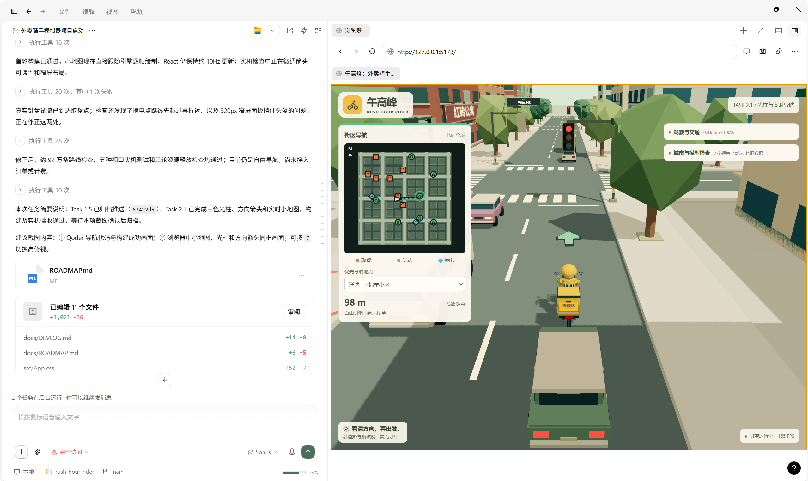

**用户确认截图：骑手实际到达幸福里小区路侧点，绿色范围圈和房屋浮标可见，小地图与标签同步显示已到达、2.5m 范围内，电量为 95%；这是自由导航到达，不是完成配送订单。**

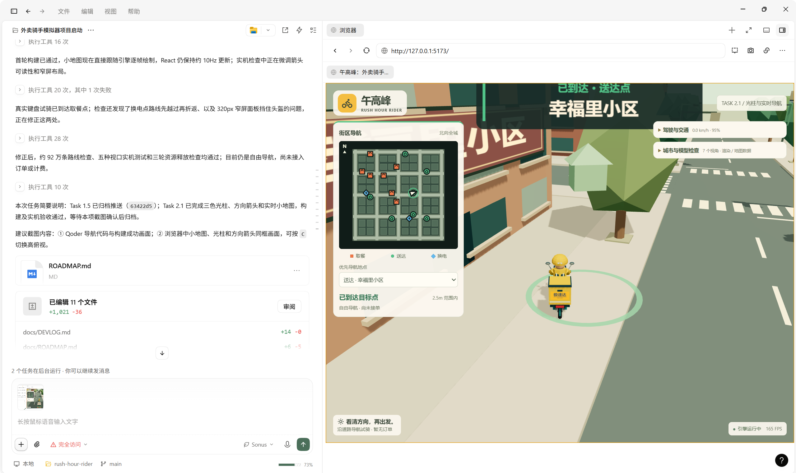

### 2026-11-21 · Task 2.2 订单调度引擎、3 单并发与分段耗时记账

简要说明：纯 TypeScript 订单状态机开局生成三单，后续按 12–20 秒有效游玩时间刷新，最多同时持有三单；接单锁定当前位置的直线限时估算，真实进入路侧范围自动取餐、切换送达导航并按整数分结算基础费、准时奖与超时扣款。每单独立记录行驶、等红灯和普通停车，尚未实现的卡餐/末端/突发保持零；账本与交通共用游玩时钟，检查与后台暂停，多单时间不冒充班次时长。新增可折叠订单操作和完整账单，当前仅展示激活订单与换电目标；尚未制作拟真手机、HUD 或现实事件。

验收结果：54 个独立模型用例、737958 次断言、55087 次账本检查与 216 次等红灯几何断言通过，覆盖 6 小时派单、1 小时 141 单配送和 30/60/144Hz 账本守恒；修复连续穿过取送范围与派单替换槽位边界。生产版真实键盘完整配送实测 35.458 秒、结算 ¥5.28（仅该次测试），三单上限、导航切换、暂停恢复、重置、五视口与原生控件通过；三轮每轮 89 项自有资源释放检查通过。`npm run build` 通过，产物约 951 KB（gzip 约 261 KB），保留既有单 chunk 超过 500 KB 提示；正常浏览器控制台无 error/warn、无外部素材或失败请求。

**用户确认截图：Qoder 验收过程与三单在途同屏，持有 3/3 时新单按钮禁用；优先导航指向蜜雪甜茶，沿路距离 180m，多单真实倒计时可见。**

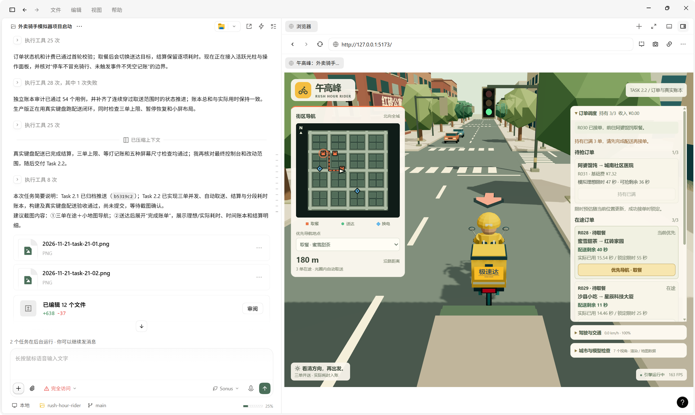

**用户确认截图：R030 送达后提示超时扣款已明细记账，持有回到 0/3、累计收入 ¥6.51，取送目标清除，仅保留两个换电地点；该原图未展开完成账单，因此不将其描述为分段明细截图。**

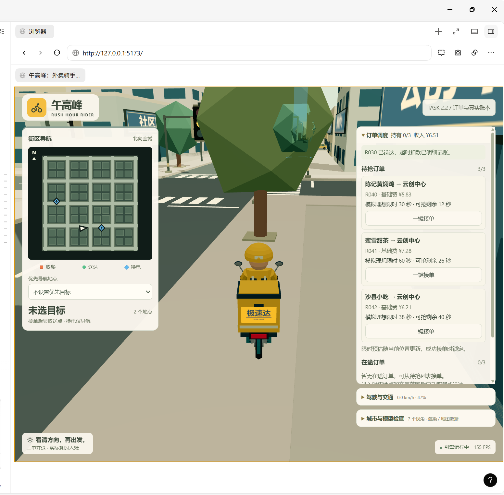

### 2026-11-21 · Task 2.3 右下角拟真骑手手机 App

简要说明：新增黄黑圆角手机机身与抢单大厅、配送中、消息·账单三个真实业务页；收起时显示最急订单、当前取送目的地和未读新单，支持画布 Tab 收放、Esc 关闭与原生控件 Tab/Shift+Tab 遍历。订单卡联动光柱和地图，低于 30 秒红色轻脉冲提醒，支持优先导航和去重异常报备；报备只保存玩家选择，不伪造耗时或减免扣款。消息仅由实际接单、取餐、剩余 15 秒提醒、报备和结算触发，钱包保留完整真实账本；顺路标记采用明确标注的直线增量估算。手机时钟为游玩时间、电量为真实车电，尚未制作 Task 2.4 HUD、班次时钟或看手机风险效果。

验收结果：`npm run build` 含类型检查通过，生产资产约 985 KB（gzip 约 270 KB），保留既有单 chunk 超过 500 KB 提示。2000 步模型检查覆盖消息阈值、报备去重与计费不变、快照隔离和重置；另验证取餐后顺路估算正例。真实 Chrome 键盘完成 R002 接单取送，实际耗时 34.480 秒、实得 ¥5.33（仅该次测试），消息与账本一致。满单、未读新单、优先导航、原生焦点、检查/后台暂停、重置、减弱动画偏好及驾驶回归通过；五种视口下展开手机占屏约 15.3%–34.0%，无横向溢出，额外检查 601×501 断点与六尺寸收起态头盔无遮挡。正常浏览器控制台无 error/warn、无外部素材或失败请求。

**用户确认截图：Qoder 开发验收过程与手机「配送中」同屏，R050 沙县小吃送往育才小学，持有 1/3，剩余 00:29 呈红色警示、基础费 ¥7.05，取餐导航沿路 12m。**

**用户确认截图：R050 已送达，手机「消息·账单」显示本班实得 ¥5.30、完成 1 单，结算消息明确超时扣款 ¥1.75，商家交接消息和新单徽章可见；完成账单折叠，原图不作为展开分段明细的证据。**

### 2026-11-21 · Task 2.4 顶部 HUD 状态栏与“低头看手机”风险联动

简要说明：因 Qoder 额度耗尽，自 Task 2.4 起经批准临时切换 Antigravity 继续按原路线图与留痕规范推进。新增顶部紧凑 HUD（`11:30 → 13:30` 模拟午高峰时钟与 3.5 分钟倒计时条、今日收入、完成与在途单数、真实准时率、电动车电量条、骑手体力条、视角循环按钮及本地持久静音开关）与 `13:30` 收工提示条；同步骑手手机状态栏时钟为午高峰时间。接入“低头看手机”风险联动：停车（速度 < 0.8 m/s）展开手机视野清晰，骑行中展开手机触发 3D 视口边缘径向虚化与红边晕影、克制镜头轻晃、转向灵敏度下降及车辆剐蹭风险半径增大，并弹出红色警示条“边骑边看手机，注意前方路况！”，刹停或收起手机立即恢复清晰；至此 Stage 2 完整垂直切片可玩。

验收结果：`npm run build`（`tsc --noEmit` + Vite）通过，生产产物约 1005 KB（gzip 约 275 KB），保留既有单 chunk 超过 500 KB 提示。浏览器实机验证顶部 HUD 全项数值、视角与静音切换、停车看手机清晰安全、加速骑行展开手机触发边缘虚化/红边警示与电量/体力真实变化、刹停立即恢复清晰，控制台无报错、无失败请求。

**用户确认截图：实机游玩至午高峰 `13:26`（剩 `00:07`），已完成 2 单、在途 1/3、今日收入 ¥13.42、准时率 50%、电量 58%、体力 98%；以 +36.0 km/h 骑向老王烧烤（R013，沿路 62 m）时展开手机，画面边缘出现红晕虚化与顶部红色警示“边骑边看手机，注意前方路况！”，HUD 与手机文字保持清晰，该设备显示 165 FPS，不代表所有设备的帧率。**

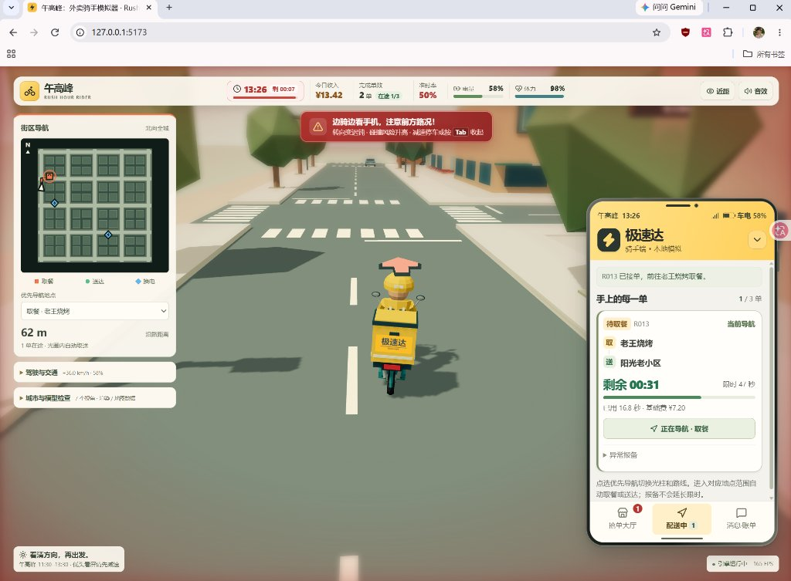

### 2026-11-21 · Task 3.1 交互事件引擎 + 前 5 个高频送餐现场事件

简要说明：搭建纯 TypeScript 单通道事件调度引擎 `EventSystem`（含冷却防刷屏与未见优先轮换）及居中事件决策卡 `EventModal`（≤ 2 行精炼文案、`1`/`2` 快捷决策键、3 秒连按 `Space` 步行冲刺条与决策后非阻塞结果提示条）；落地前 5 个送餐现场事件（商家爆单卡餐、老旧小区禁入电驴、CBD 写字楼午高峰电梯爆满、顾客填错定位、外卖柜已满）。触发事件时自动刹停车辆与车流防剐蹭，选择结果后的真实卡餐/末端/绕路耗时同步扣入在途订单倒计时与 `OrderTimeLedger`（严格保持各分段之和 = `actualSec`），小费与异常/差评扣款写入结算明细与手机消息流。同时根据国内配送现实反馈，在路线图中增补临时插播任务 `Task 3.1b`，后续将“老旧小区禁入电驴”修正为更贴合现实的“高端封闭小区禁入电驴”。

验收结果：`npm run build`（`tsc --noEmit` + Vite）通过，生产产物约 1033 KB（gzip 约 283 KB），保留既有单 chunk 超过 500 KB 提示；独立校验脚本确认 5 类事件触发、`Space` 连点冲刺与账本守恒全通。浏览器实机验证接单 `R001` 抵达沙县小吃触发「商家爆单卡餐」、车速归零、按 `1` 键选择「死等出餐」后自动扣入真实卡餐时长并切换送达导航，控制台无 error/warn、无失败请求。

**用户确认截图：Antigravity 开发完成汇报与浏览器实机同屏；`R001` 驶抵沙县小吃（沿路 3 m、剩 00:17）触发居中决策卡「商家爆单卡餐」，显示 `[1] 死等出餐` 与 `[2] 报备转单` 两个方案及真实耗时/信誉影响，顶部 HUD 显示 `11:36`、电量 `99%`、体力 `100%`。**

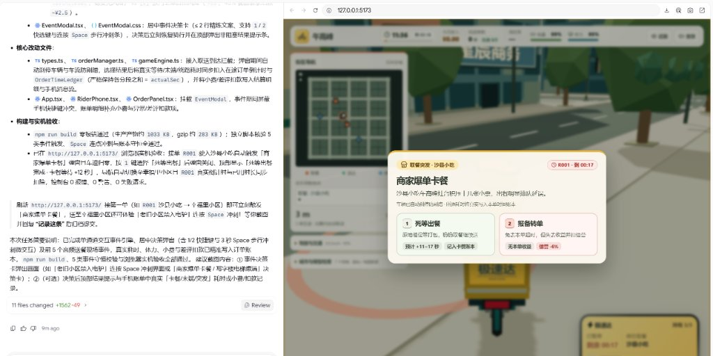

### 2026-11-22 · Task 3.1b 停驻支腿平衡、真实转弯半径、鼠标自由视角与限时微调

简要说明：优化电动车基础驾驶真实感与派单节奏：将订单理想限时由 `max(25, ceil(距离/8 + 12))` 温和放宽为 `max(34, ceil(距离/6.8 + 18))`；将骑手左腿拆为独立关节网格，停车或极低速（< 0.65 m/s）时顺滑伸出踩地支撑平衡并伴随轻微左倾，起步后自动收回踏板；调整两轮电驴有效轴距（1.28 m）与随速转向曲线，提升低速灵活掉头与中高速路口过弯手感；接入第三人称骑行鼠标拖拽自由环视、滚轮缩放、建筑避障防穿墙与骑行自动回正/双击回正。

验收结果：`npm run build`（`tsc --noEmit` + Vite）通过，生产产物约 1039 KB（gzip 约 284 KB）；物理与限时校验确认开局限时为 34s / 34s / 46s、起步收腿与停驻支腿状态切换准确。浏览器实机验收 `W+A` 敏捷转弯、刹停、鼠标自由环视左前方近景清晰可见骑手左腿撑地与右脚搭踏板，控制台无 error/warn、无失败请求。

**用户确认截图：Antigravity 开发汇报与浏览器实机同屏；使用鼠标自由环视拉近至骑手左前方，清晰展示骑手停驻时左腿伸出踩地支撑平衡、右腿搭在踏板上及后方公交车，左下角可见自由视角操作提示。**

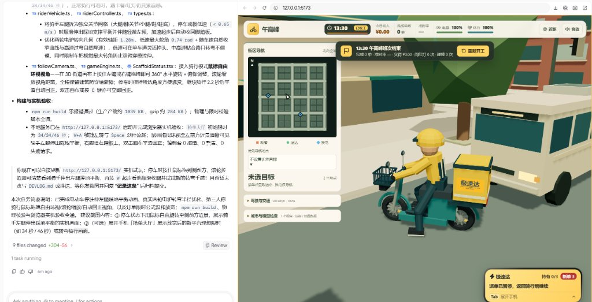

### 2026-11-22 · Task 3.0a & Task 3.0b 建筑底部 Z-Fighting 修复与鼠标免按键自由控视角

简要说明：合并完成两项插播优化：① **Task 3.0a** 将 `worldBuilder.ts` 建筑主体墙面垂直堆叠在 `0.7m` 底座之上（零垂直重叠、严格保留原 2D AABB 碰撞边界），同步消除写字楼四角柱共面、街区底板与人行道外缘路缘共面及内庭草坪/广场垂直重叠，并将相机近裁剪面 `near` 提至 `0.35`，彻底消除移动时建筑底部条纹屏闪；② **Task 3.0b** 将第三人称骑行自由视角改为鼠标悬停在 3D 画布上移动即可丝滑转动（无需左键按住），左右水平偏航严格限幅为 ±135°（总广度 270°），上下俯仰设置安全上下限防穿地与翻转，保留滚轮缩放、建筑防穿墙避障及双击/`C` 键回正，移至 UI 区域时视角稳定不乱晃。

验收结果：`npm run build`（`tsc --noEmit` + Vite）通过，生产产物约 1037 KB（gzip 约 284 KB）。浏览器实机验收免按键左右/上下移动鼠标流畅侧头并安全限幅、移回中心自动回正；近景紧贴店铺绿底墙根与米黄外墙清晰锐利、零条纹屏闪，控制台无 error/warn、无失败请求。本条经用户确认无需附截图直接归档。

### 2026-11-22 · Task 3.1c 4 倍扩容 8×8 多元中国街区与“高端封闭小区禁入电驴”修正

简要说明：将微缩城市由 4×4（360m×360m）扩至 4 倍面积的 8×8（720m×720m），扩展出 8 大差异化中国特色功能区（烟火美食街、星光商业夜市、老旧红砖小区、翡翠高端住宅区、星辰 CBD 商务区、智谷科创产业园、社区医院与学园、南城大学城），共 64 个街区、256 栋合批建筑、18 条双向道路、81 个路口、26 个具名地标与 6 处换电站；同步扩展 49 处动态红绿灯与 28 辆跨区车流，小地图升级为「局部跟随 / 全城 8×8」一键切换。同步完成国内现实设定修正：将原“老旧小区禁入电驴”重构为「高端小区禁入电驴」，仅在御景华府/翡翠云邸/铂金公馆等高端封闭物业小区触发（含 3 秒连按 Space 步行冲刺与绕道物业侧门方案），老旧小区回归可骑车直达。

验收结果：`npm run build`（`tsc --noEmit` + Vite）通过，生产产物约 1044 KB（gzip 约 287 KB）；全城完整性校验确认 256 栋建筑零重叠、32 个交互圈最小净空 3.25 m、32 条路网导航全通、高端与老旧小区事件分流准确。浏览器实机验收 8×8 全城俯瞰、翡翠高端门楼外观、小地图切换与御景华府实际送达触发「高端小区禁入电驴」，控制台无 error/warn、无失败请求。

**用户确认截图：Antigravity 开发汇报与 8×8 八大功能区「全城俯瞰」实机同屏，11 个检查视角与局部跟随小地图清晰可见。**

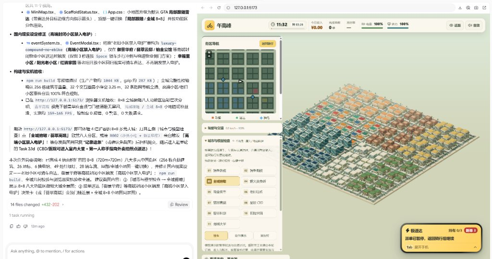

**用户确认截图：`R002` 实际骑抵「御景华府」高端封闭小区门口（沿路 3 m、剩 00:16）触发居中决策卡「高端小区禁入电驴」，提供 `[1] 锁车步行冲刺` 与 `[2] 绕道物业侧门` 两个方案，背景可见香槟金顶与物业门楼。**

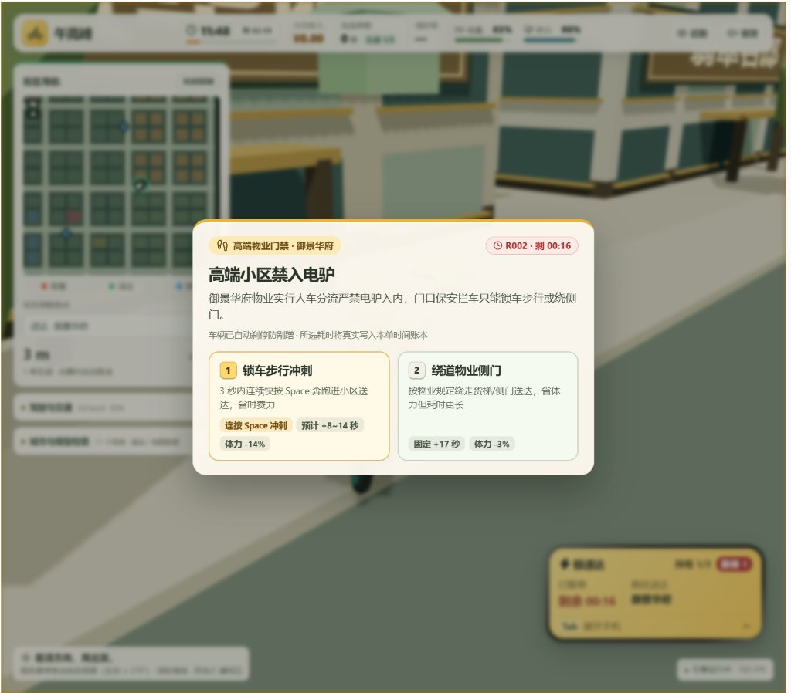

### 2026-11-22 · Task 3.1d CBD/医院可进入室内大堂与第一人称“手指向外卖”拍照送达

简要说明：新增纯程序化 3D 室内大堂与第一人称交付模块 `interiorScene.ts`，为 CBD 写字楼（星辰科技大厦/云创中心/天穹金融中心/智谷研发园）与医院（城南社区医院/市一院南分院）提供可进入的一楼大堂/门诊大厅（含接待前台、门禁闸机/导诊台、人流剪影及「外卖存放处」专架）；支持 `WASD` 室内步行与鼠标免按键侧头观察，走到放餐点自动放置带本单动态小票（单号 + 商家名）的「极速达」外卖袋。在骑手手机 App「配送中」卡片接入「拍照点送达（第一人称留证）」入口（同步支持 `F` 键），切入第一人称拍照取景器——程序化黄袖骑手手臂与伸出食指清晰指向桌上的外卖袋，叠加实时时间/地点/订单水印与快门确认闪光，室内全部耗时真实写入 `lastMileSec` 账本，拍完自动结算并返回室外电动车。

验收结果：`npm run build`（`tsc --noEmit` + Vite）通过，生产产物约 1077 KB（gzip 约 295 KB）。浏览器实机跑通 `R001`（蓝鲸精品咖啡 → 星辰科技大厦）接单取餐、骑抵大堂按 `E` 进楼、步行至外卖存放处、手机 App 点击拍照点送达、快门确认入账 ¥7.55 并自动返回室外电动车全链路，同步修复路侧入楼提示条与折叠手机卡片的轻微重叠；控制台无 error/warn、无失败请求。

**用户确认截图：星辰科技大厦 CBD 一楼外卖存放架第一人称「极速达 · 拍照点送达」实机画面；黄黑袖骑手左手伸出食指清晰指向带 `#R001 蓝鲸精品咖啡` 动态小票的外卖袋，左下角显示「极速达配送存证 2026-11-22 11:59 · 星辰科技大厦 · CBD 一楼外卖存放架」实时水印，右下角为「拍摄并确认送达 Space」快门按钮。**

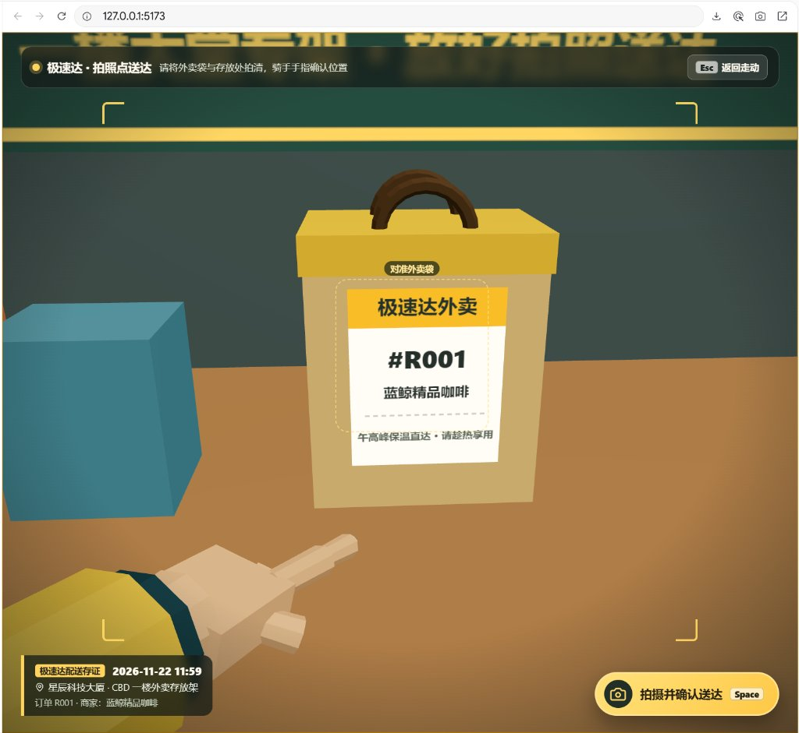

## 2026-11-22 · Task 3.2：后 5 个动态路况/运营事件 + 街角换电柜闭环
- **完成内容**：
  - 在 `src/game/eventSystem.ts`、`src/game/orderManager.ts`、`src/game/riderController.ts`、`src/game/interiorScene.ts` 与 `src/game/gameEngine.ts` 补齐后 5 类动态运营与路况事件：手持 2 单自动触发「高价顺路加单弹窗（+¥9.00，支持 1/2 快捷键接单或稳妥拒绝）」、在途订单剩 ≤ 18 秒顶部弹出非阻塞「顾客催单来电（1/2/3 话术影响信誉与好评，阻塞弹窗到来自动让位）」、路口红灯安全等灯读秒胶囊与闯红灯违章扣款/警告（信誉 -5%、65% 概率罚款 ¥2.00 记入运营成本）、电量 < 20% 限速（6.2 m/s、禁冲刺）与 6 处街角蓝色换电柜停车 3 秒扣费 ¥2.00 满电闭环，以及体力 ≤ 20% 透支减速（室内步行降至 3.0 m/s、冲刺目标增至 13 次、停车恢复提至 2.4%/s）。
  - 在 `src/components/EventModal.tsx`、`src/components/EventModal.css` 统一收口顶部单通道非阻塞浮层（来电条 / 3 秒换电进度卡 / 结果提示 / 实时状态胶囊零重叠），并在 `src/components/HudBar.tsx` 顶部栏新增紧凑「信誉」实时指标。
- **验收结果**：`npm run build` 零错误通过（生产包约 `1,035.51 KB` / gzip `287.73 KB`）；Node 逻辑校验 5 项机制全通；浏览器实机验收确认顶部「信誉 100%」单行无拥挤、双单触发高价顺路加单弹窗及顶部非阻塞顾客催单来电流畅可交互，实测 155–165 FPS，控制台 0 报错、0 警告。
- **截图归档**：

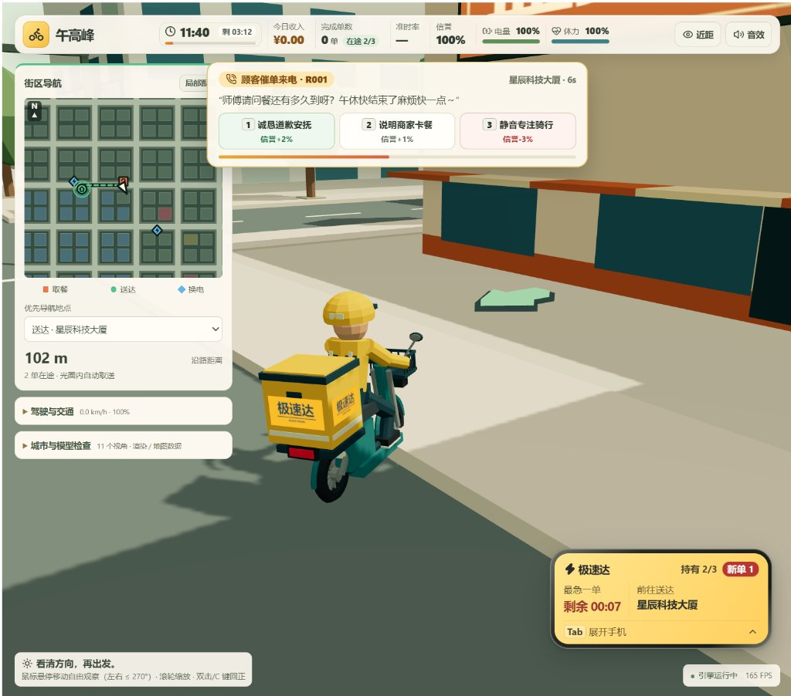

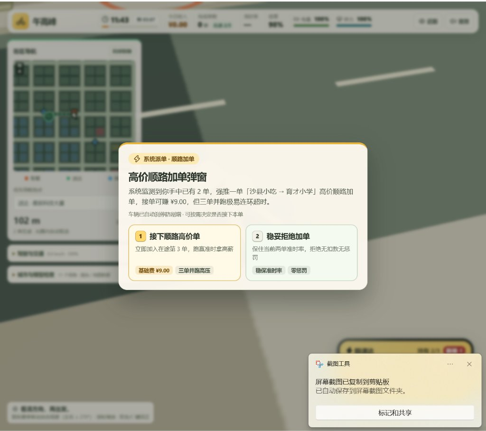

## 2026-11-22 · Task 3.3：午后突发阵雨动态天气与路面打滑系统
- **完成内容**：
  - 新增纯 TypeScript 动态天气模块 `src/game/weatherSystem.ts`：班次推进至 45%–76% 时自动平滑触发「午后突发阵雨」，同时在顶部 `HudBar.tsx` 提供「晴朗 / 阵雨 +¥2」一键切换按钮；天空、雾效距离、日光与半球光约 2 秒内平滑过渡至冷灰蓝雨天氛围，1,350 颗带斜风感的程序化细雨丝采用单一 `Points` 几何体 + Canvas 2D 纹理（1 次绘制调用）。
  - 在 `src/game/worldBuilder.ts` 为全城街灯增加合批暖黄体积光锥与地面光晕（仅 2 次绘制调用，零 `PointLight` 性能损耗）；在 `src/game/riderVehicle.ts` 为电动车车头灯增加雨天自动增亮与随车把转向的暖白光锥及路面光斑。
  - 在 `src/game/riderController.ts` 接入湿滑路面物理（雨天刹车减速度降低约 36%，制动距离约 1.57×，过弯侧向抓地力降低带来柔和可控的湿滑漂移）；在 `src/game/orderManager.ts` 与 `src/components/OrderPanel.tsx` 接入雨天送达自动结算「雨天补贴 +¥2.00」。
- **验收结果**：`npm run build` 零错误通过（生产包约 `1,046.13 KB` / gzip `290.93 KB`）；Node 物理与补贴校验通过；浏览器实机验收确认雨天视觉氛围、路灯光锥、车头灯与湿滑巡航稳定，实测 155–165 FPS，控制台 0 报错、0 警告。
- **截图归档**：

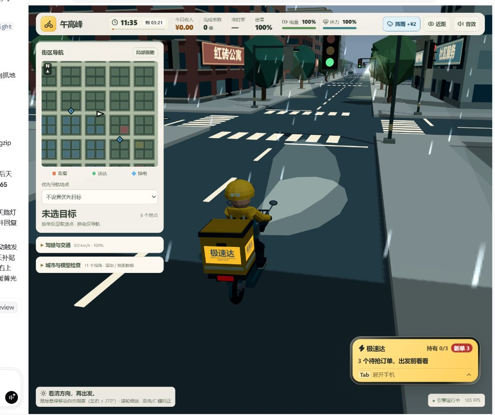

## 2026-11-22 · Task 3.4：纯 Web Audio API 程序化音效与静音控制
- **完成内容**：
  - 新增纯 TypeScript 音效引擎 `src/game/audioEngine.ts`（零外部 `.mp3` / `.wav` 文件依赖），基于浏览器原生 Web Audio API 实时合成随车速/冲刺动态变调的轻柔电驴电机声、按 `H` 清脆双音电驴喇叭、新单叮咚、取餐提示、送达四音金币和弦、拍照点送达快门咔嚓声、顾客催单铃振、换电满血提示、闯红灯违章警告、防抖碰撞闷响，以及随雨势渐入渐出且进入室内自动衰减 70% 的柔和粉红噪音雨声。
  - 在 `src/game/gameEngine.ts` 与 `src/components/HudBar.tsx` 接入首次用户交互自动解锁 `AudioContext`（兼容浏览器自动播放策略无异常）、顶栏一键静音（主 `GainNode` 即时归零并持久化至 `localStorage`）及卸载资源完整释放。
- **验收结果**：`npm run build` 零错误通过（生产包约 `1,054.06 KB` / gzip `293.05 KB`）；浏览器实机验收确认零外部音频请求、自动播放策略零报错、鸣笛/电机/雨声及顶栏静音切换与刷新持久化正常，实测 135–163 FPS，控制台 0 报错、0 警告。按用户指示本次无需归档截图。

## 2026-11-23 · Task 4.1：开局沉浸式主界面、模式切换与 10 秒新手引导
- **完成内容**：
  - 在 `src/game/followCamera.ts`、`src/game/gameEngine.ts` 与 `src/game/types.ts` 接入未开局实时 3D 街区缓动环绕镜头（车流与红绿灯正常运行、冻结班次/派单倒计时、隐藏导航光柱与 HUD）及双模式会话管理（`challenge` 午高峰 3.5 分钟挑战 / `free` 无限时长自由骑行，点击顶栏左上角品牌区可随时返回主界面切换模式）。
  - 新增 `src/components/StartOverlay.tsx` 与 `StartOverlay.css`：半透明磨砂开局主卡展示标题《午高峰：外卖骑手模拟器》、Hack4Good 立意引言、双模式切换卡片、6 组清晰键位图与「上线接单」（支持 `Enter` 快捷开局并自动解锁 Web Audio 音效）。
  - 新增 `src/components/ControlsHint.tsx` 与 `ControlsHint.css`：开局底部居中动态 3 步新手指引（`按 Tab 抢第一单 → 跟橙柱取餐 → 跟绿柱送达`），随接单/取餐/送达实时打勾推进并自动收起，窄屏自动避让至右上角不遮挡小地图与骑手手机。
- **验收结果**：`npm run build` 零错误通过（生产包约 `1,062.73 KB` / gzip `295.82 KB`）；浏览器实机验收确认开局动态 3D 街区背景与磨砂主卡居中纯净无干扰、自由/挑战双模式切换与底部 3 步引导实时联动正常，实测 163 FPS，控制台 0 报错、0 警告。
- **截图归档**：

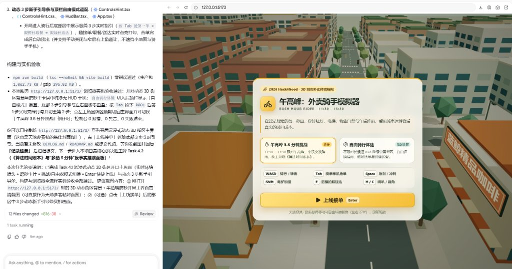

## 2026-11-23 · Task 4.2：《算法时间账本》与“多给 5 分钟”反事实推演面板
- **完成内容**：
  - 新增纯 TypeScript 账本聚合与反事实推演模块 `src/game/counterfactual.ts`：`buildShiftSummary()` 真实汇总全班次完成单数、准时率、毛收入、扣款/运营支出、实得净收入、信誉安全记录与非骑行时间占比并颁发客观骑手称号；`evaluateCounterfactual()` 支持 `+0 → +8` 分钟缓冲滑块，基于本局每单真实超时秒数与闯红灯记录动态重算准时率跃升、可免闯红灯冒险与多保住的净收入（0 单/空局/自由模式零 `NaN` 零除零）。
  - 新增收工结算大屏 `src/components/SettlementModal.tsx` 与 `SettlementModal.css`：展示骑手称号卡、净到手主卡、4 格核心 KPI、「平台理想预估 vs 现实实际耗时」6 段横向堆叠柱状图，以及 `+0/+3/+5/+8 分钟` 快捷档位与滑动反事实对比面板。
  - 在 `src/game/gameEngine.ts`、`src/components/HudBar.tsx` 与 `src/App.tsx` 接入顶栏「收工」提前结算入口、自由模式/中途结算的「继续当前局」恢复与「再来一局」重置，并修复了 `RiderPhone` 与 `SettlementModal` 同级 React `key` 冲突。
- **验收结果**：`npm run build` 零错误通过（生产包约 `1,080.09 KB` / gzip `301.35 KB`）；Node 反事实校验全通；实机 5 单真实午高峰跑局完整呈现「雨中逆行者 · 平台理想 234.0s vs 现实实际 521.1s（卡餐 64.0s / 进楼门禁 50.3s / 绕路 39.0s）」及拖动缓冲滑块实时对比，浏览器复验 159 FPS、控制台 0 报错。
- **截图归档**：

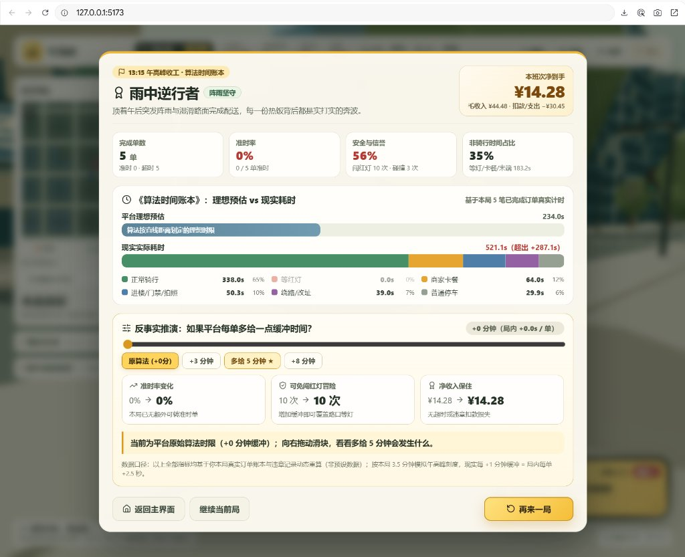

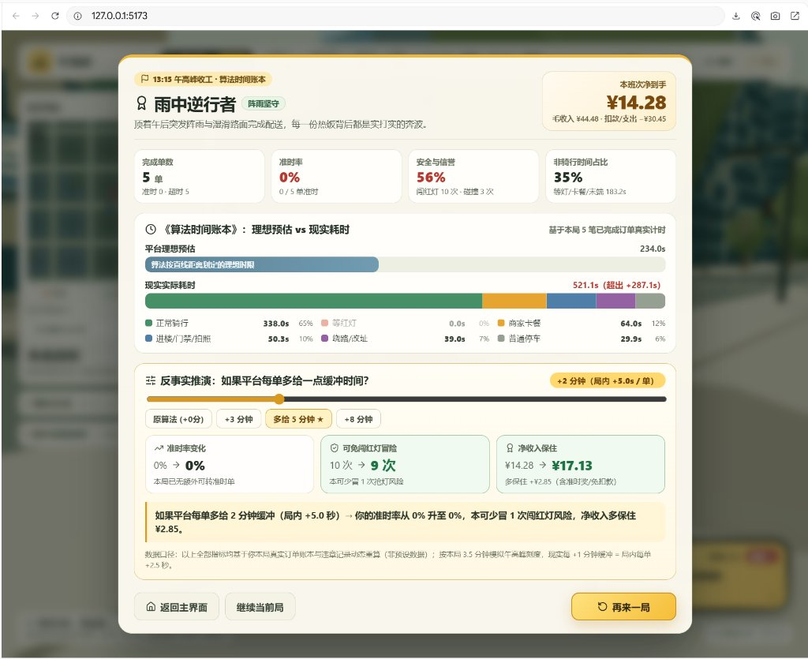

## 2026-11-23 · Task 4.3：收工战报海报一键导出 PNG 与再来一局重置
- **完成内容**：
  - 新增纯 Canvas 2D 战报生成器 `src/components/sharePoster.ts`（零 `html2canvas` 等外部导出依赖），本机直接绘制 `900×1200` 暖纸票据风高清战报 PNG（含底部撕纸锯齿装饰、骑手称号印章、净到手主卡、4 格核心战绩、《算法时间账本》理想 vs 现实堆叠柱与 6 项彩色图例、「多给 5 分钟」反事实对比卡与自动换行洞察金句），在 `src/components/SettlementModal.tsx` 接入「下载今日骑手账单海报」一键导出按钮与保存反馈。
  - 在 `src/game/gameEngine.ts` 完善 `resetShift()`（`resetRider()` 委托调用），确保点击「再来一局」进入第 2 局时位置、时钟、订单、车流、喇叭、刹车尘、天气大气与街灯光晕、室内模式、分心状态、事件/换电与 Web Audio 持续电机/雨声音量全部彻底归零重启。
- **验收结果**：`npm run build` 零错误通过（生产包约 `1,090.67 KB` / gzip `304.65 KB`）；完整 13:30 午高峰 4 单实机局一键导出 `900×1200` PNG 战报排版清晰零错位，点击「再来一局」瞬间从阵雨复原晴朗重启第 2 局，实测 141–161 FPS，控制台 0 报错、0 警告。
- **截图归档**：

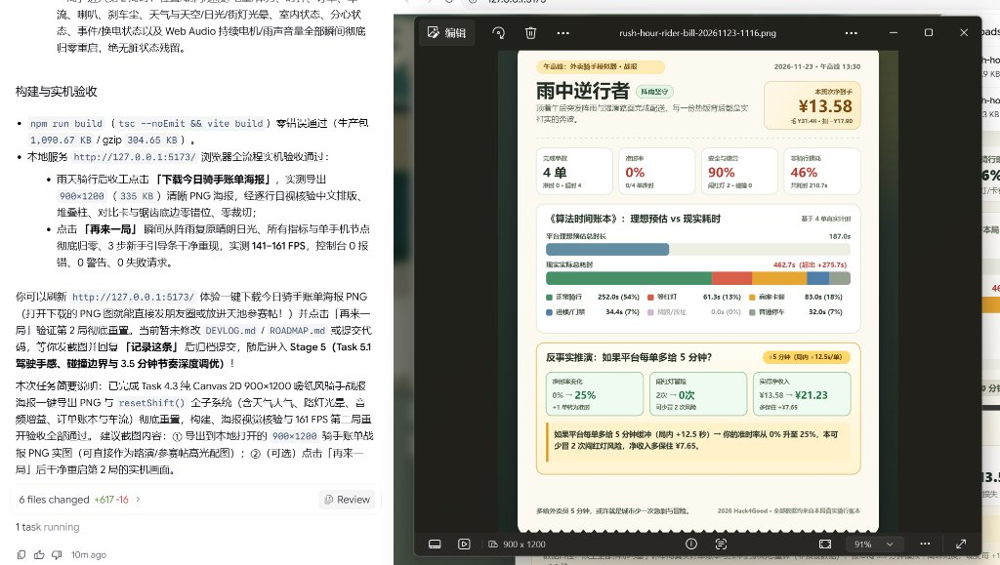

## 2026-11-23 · Task 5.1：驾驶手感、碰撞边界与 3.5 分钟节奏深度调优
- **完成内容**：
  - 自动化审计全城 26 处取送地标 + 6 处换电柜：最小建筑净空 `5.75 m`，路网可达 100%，零卡墙。
  - `riderController.ts`：巡航 `11.4 m/s`（≈41 km/h）、冲刺 `16.2 m/s`（≈58 km/h）、加速与转向跟手度提升，擦墙摩擦柔化防粘滞。
  - `orderManager.ts` / `OrderPanel.tsx`：理想限时校准为 `max(40, ceil(dist/5.4 + 24))`，派单半径收紧至取餐 ≤220m、送达 ≤270m。
  - `eventSystem.ts`：现场事件冷却 `24s`、催单来电冷却 `28s`、加单冷却 `48s`，卡餐/等梯耗时微调，避免弹窗扎堆。
  - `gameEngine.ts` / `HudBar.css`：结算时屏蔽驾驶热键；`≤1320px` 顶栏紧凑排版，`1280×720` 单行不折行。
- **验收结果**：`npm run build` 零错误；3 局 210 秒全长仿真（单跑 5 单 100% / 双单 6 单 67%→83% / 三单 6 单 33%→50%）且账本守恒；浏览器 `1280×720` + `1440×900` 实机 155–165 FPS、控制台 0 报错。按用户指示本次无需归档截图。

## 2026-11-23 · Task 5.2：性能/包体积体检、Esc 暂停菜单与窄屏友好兜底
- **完成内容**：
  - `vite.config.ts` 接入 Vite 8 / Rolldown 代码分包：`three` 与 `react-vendor` 拆为独立 chunk，并设置 `chunkSizeWarningLimit: 700`，生产构建不再出现大包告警；产物 5 个文件合计约 `1.18 MB`（gzip `324.28 KB`，低于 500 KB 目标），本机生产预览开局卡片可见耗时 `1.44–1.56 s`。
  - 新增 `PauseOverlay.tsx` / `PauseOverlay.css`：支持 `Esc` 或顶栏「暂停」按钮进入磨砂暂停卡，提供「继续骑行 / 重置视角 / 提前收工看账本 / 返回主界面」四项操作；`gameEngine.ts` 新增 `setPaused` / `togglePause` / `resetView` 与 `ShiftSnapshot.paused`，暂停时冻结班次时钟、订单限时与派单倒计时、红绿灯与车流、天气雨丝、第三人称自动回正以及持续电机/雨声音量，恢复后从原处无缝继续。
  - 窄屏兜底：`StartOverlay` 在触屏或 `≤760px` 设备展示「手机 / 平板体验提示」，并对 `≤520px` 矮窗口压缩卡片，保证「上线接单」按钮首屏可见；`ControlsHint` 在窄屏 / 矮屏 / 触屏下隐藏键盘引导，避免与顶栏重叠；`390×844`、`700×390`、`844×390` 三档视口均无横向溢出、无面板遮挡。
  - `HudBar.tsx` / `HudBar.css` 新增暂停按钮；`focusCanvas` 不再在无用户手势时创建 `AudioContext`，消除首屏自动播放策略告警。
- **验收结果**：`npm run build` 零错误通过（`three` 607.92 KB / gzip 151.51 KB；`react-vendor` 235.89 / 74.69；业务 253.38 / 80.21；CSS 85.15 / 17.21；gzip 合计 324.28 KB）。独立 Chrome + GPU 自动化实机验证：暂停 1.8 秒期间模拟时钟与剩余时间完全不变，恢复后时钟继续推进（03:28 → 03:26）；顶栏暂停按钮、重置视角、提前收工结算、返回主界面全部可用；手机展开时 `Esc` 优先收起手机、再按进入暂停；`1440×900` 实机 161–165 FPS，全部视口控制台 0 error / 0 warning。
- **截图归档**：

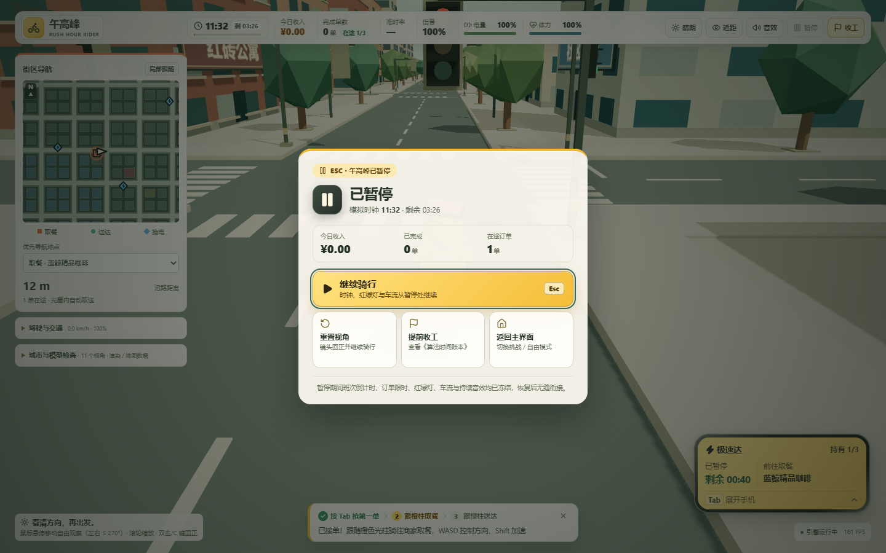

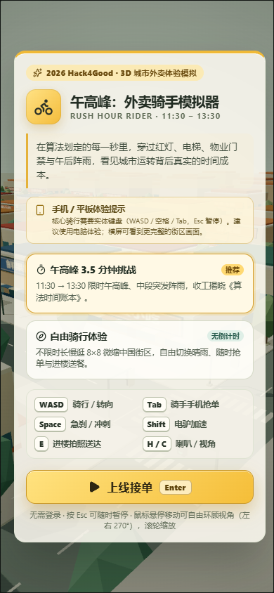

## 2026-11-23 · Task 5.2+ 部署前加固复检（暂停体系 / 自适应画质 / 窄屏兜底）

**背景**：Task 5.2 原验收项已由上一轮完成并提交 `b11c5cf`；本条为公网部署前的独立复检与加固，不回退或重复原有实现。

**完成内容**：
- `gameEngine.ts` 新增自适应渲染倍率：按持续帧率在 `1 → 0.85 → 0.72` 间逐级升降，使用真实墙钟避免低帧率下游戏内时钟过慢导致永不触发；技术面板同步展示「画质倍率」。
- 暂停体系补强：新增 `PauseReason`（手动 / 切页 / 渲染中断）；`visibilitychange` 时自动暂停并挂起 `AudioContext`，回到前台保持暂停由玩家确认；室内步行现在也可暂停；暂停卡加入焦点陷阱与原因文案。
- WebGL 上下文丢失/恢复：监听 `webglcontextlost/restored`，自动暂停并显示可读提示与刷新按钮，恢复后重新应用渲染倍率；实测恢复后 165 FPS。
- 窄屏兜底：开局卡改为「滚动内容区 + 固定底部 CTA」，补 `100dvh`、安全区、短屏压缩；`320×568`、`360×640`、`390×844`、`700×390` 四档「上线接单」均首屏可见，无横向溢出。暂停卡与结算页同步补 `dvh` 与安全区。
- 部署可移植性：`vite.config.ts` 设 `base: './'`；`index.html` 补 `viewport-fit=cover` 与 `og:` 元信息；全局补 `overscroll-behavior`、`touch-action`、点击高亮收敛。

**验收结果**：`npm run build` 零错误通过（`three` 607.92 KB / gzip 151.51；`react-vendor` 236.20 / 74.82；业务 258.55 / 81.76；CSS 88.01 / 17.85；HTML 1.48 / 0.85；gzip 合计 326.79 KB）。独立 Chrome + GPU 自动化：`1440×900` 骑行 165 FPS（84 draw calls / 561,006 三角形 / 40,794 实例）；暂停 1.5 秒时钟 `03:27 → 03:27` 不变；切页自动暂停且音频 `suspended`，回前台保持暂停；`WEBGL_lose_context` 丢失→恢复提示与继续按钮状态正确；四档窄屏无横向溢出；核心闭环冒烟（3 单 → 抢单 → 骑行 → 暂停 → 结算滑块 → 再来一局）通过，控制台 0 error / 0 warning。SwiftShader 软渲染压力测试确认画质自动降至 72%（canvas 576×432），降载链路真实生效。

**截图归档**：

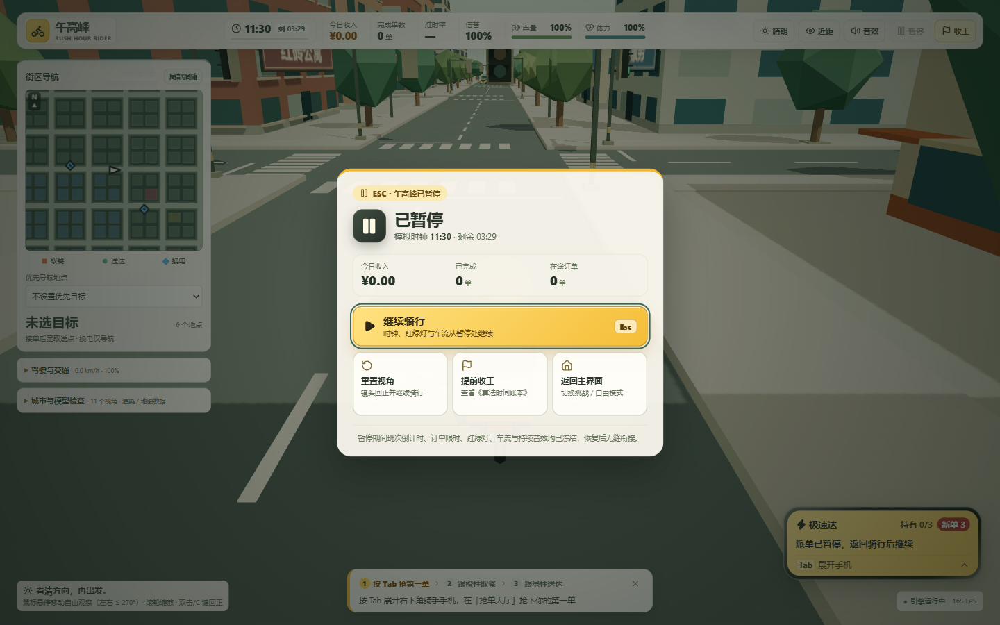

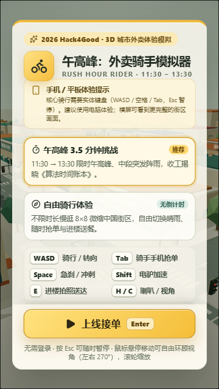

## 2026-11-23 · Day 1 作品感减法（赛前 6 天打磨）

**背景**：Task 5.2+ 归档后进入赛前 6 天深度打磨；Day 1 目标是把开发脚手架从评审画面移除，并让首屏成为“游戏海报”而不是表单卡片。

**完成内容**：
- 技术面板默认隐藏：`F3` 或 `?dev=1` 打开右侧抽屉，保留渲染/车流/城市数据与自动化入口；删除左下“看清方向，再出发。”、右下“引擎运行中 · FPS”与重复键位说明。
- 导航卡 280→208px（窄屏 172px）：只留小地图、目标名/距离、局部/全城切换；“优先目标”收进折叠项；移除常驻图例、下拉与说明。
- HUD 首单前隐藏“准时率/信誉”；≤600px 隐藏“完成单数”，390×844 HUD 高度由 150px 降至 118px。
- 开局 hero-lite：桌面左文右景，右侧保留实时 3D 街区；引言压成一句“算法算得出距离，算不出红灯、电梯与一场阵雨。”；CTA 前置；900–1440px 与 390px 窄屏首屏均可见。
- 暂停卡与开局提示加入 `F3` 技术面板入口。

**验收结果**：`npm run build` 零错误通过（gzip 合计 326.8 KB）；1440×900 实测 165 FPS、控制台 0 error / 0 warning；1440/1024/900 首屏 CTA 可见，390/360/320 无横向溢出；F3 与 `?dev=1` 开关正常；暂停/切页自动暂停/上下文丢失恢复/核心闭环（抢单→骑行→暂停→结算滑块→再来一局）全部回归通过。

**截图归档**：

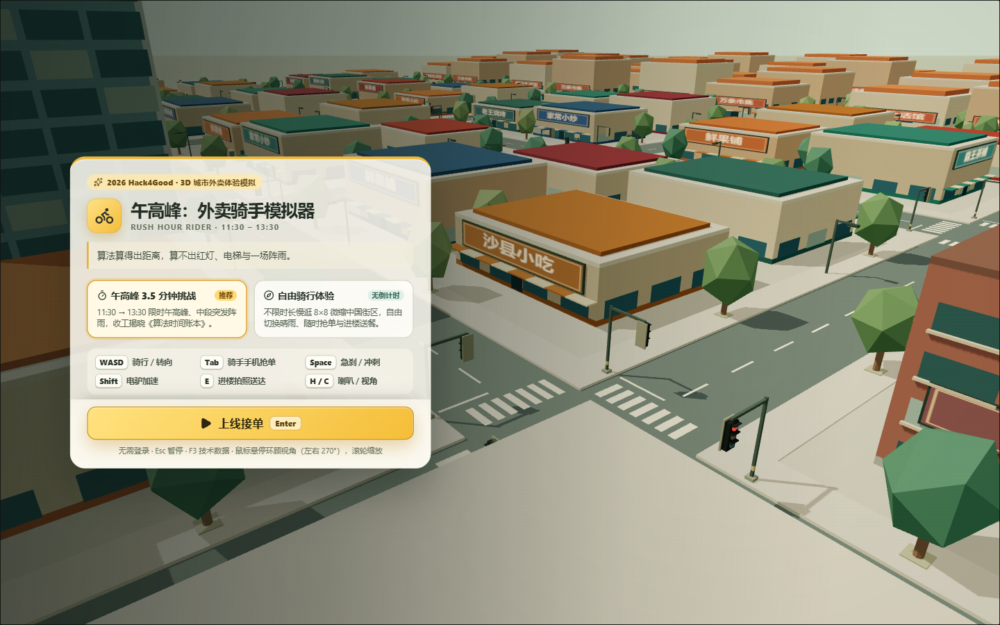

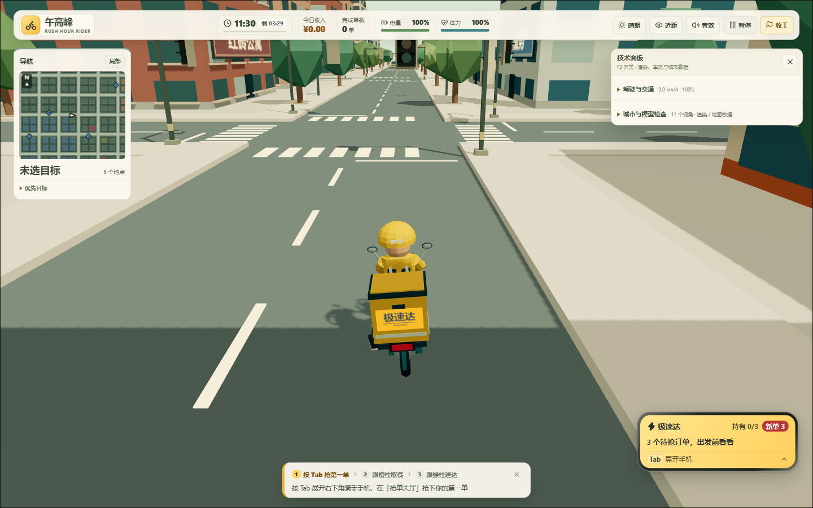

## 2026-11-23 · Day 2 第一局必须顺（赛前 6 天打磨）

**完成内容**：
- 开局三单顺序改为“先易后难”：R001 幸福里小区（可直达）→ R002 御景华府（禁入电驴）→ R003 星辰科技大厦（需进楼拍照）；首单不再是必须进楼的 CBD 单。
- 抢单大厅与配送中卡片新增送达成本标签：`可直达楼下` / `禁入电驴 · 门禁步行约 +15s` / `需进大堂 · 拍照送达约 +25s`；数据来自 `OrderManager.deliveryProfile()`，接单前即可判断。
- 首局自动展开骑手手机 3.2 秒，并提示“建议先接 1 单熟悉路线；3 单并跑更容易超时”；手机展开时新手引导改为“点击一键抢单”。
- 进楼提示半径 6.2m→12m；CBD/医院到楼下不再跳过送达事件拦截，`电梯爆满 / 外卖柜已满 / 填错定位` 从死内容变为可达。
- 修复事件冷却吞机会：`handledStages` 只在通过冷却/候选检查后写入；首局轻脚本按“卡餐 → 填错定位 → 高端小区门禁”优先消费当前可触发项，绕过 24s 冷却，仅本页第一局生效。

**验收结果**：`npm run build` 通过；1440×900 骑行 165.3 FPS、控制台 0 error/warn；抢单实测 R001 `direct`、R002 `restricted`、R003 `enter`；Node 单元校验首局脚本三项全部命中、冷却期 `handledStages` 未被消耗；`OrderManager` 校验 CBD 送达 `onArrivalIntercept` 收到 `buildingKind: office`；核心闭环冒烟通过。

**截图归档**：

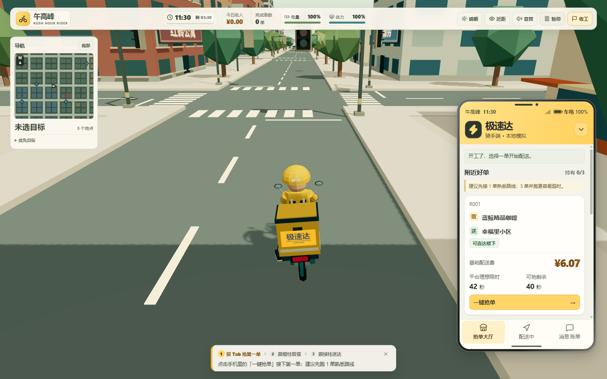

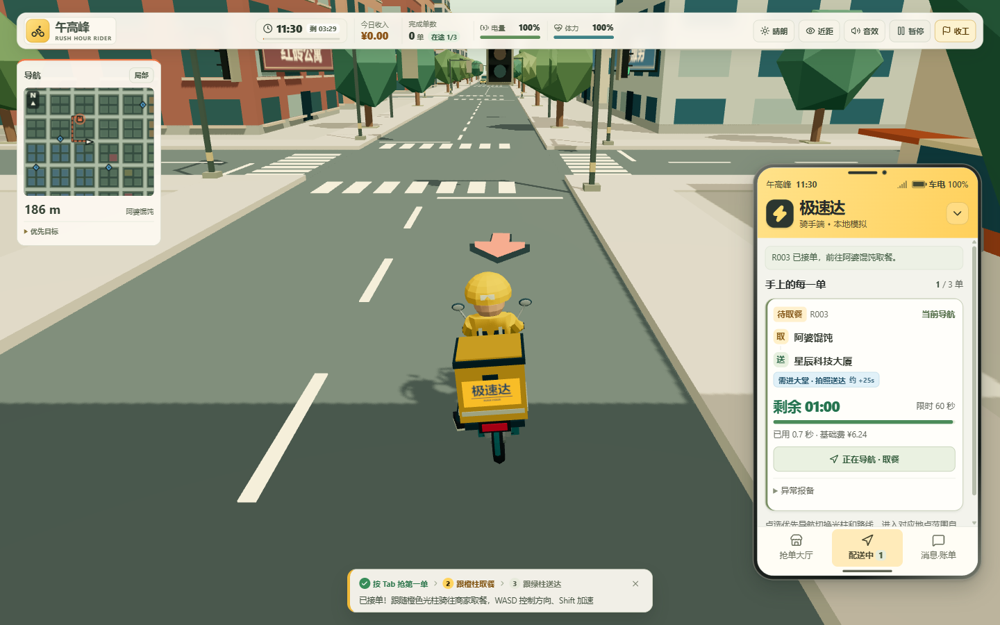

## 2026-11-23 · Day 3 让算法时间可见（赛前 6 天打磨）

**完成内容**：
- 新增 `DeliveryDeltaToast`：每单送达后 2.4 秒展示“平台预估 vs 我的现实”与最大两段耗时，准时/超时着色；实测出现与自动消失正常。
- 顶栏时钟下新增实时时间账本：3px 分段条（骑行/等灯/卡餐/进楼/绕路/停车）+ 一行“本单 / 刚送达 · 等灯 Xs · 卡餐 Ys”，每 10Hz 快照更新；窄屏隐藏文字保留色条。
- 结算页可信度修正：柱状图标签改为“累计每单配送时长”，新增“并行订单同一秒会重复计入”的口径说明；新增“逐单明细”折叠表（平台预估/我的现实/准时余量/最大耗时段）。
- 反事实推演新增“最脆弱的一单”：按真实 `deadline - completedAt` 计算缓冲，拖动 +N 分钟时同步展示缓冲变化；全准时局不再是一条平线。

**验收结果**：`npm run build` 通过（gzip 合计约 330 KB）；1440×900 165 FPS、控制台 0 error/warn；通过 `?dev=1` 引擎句柄完成一单后，送达 Toast 出现并在 2.6 秒后消失，HUD 显示“刚送达 · 停车/等待 1s”；结算实测标签、口径说明、逐单明细与“最脆弱的一单 +5 分钟缓冲 41.1s→53.6s”均正确；390×844 HUD 高 121px、无横向溢出。

**截图归档**：

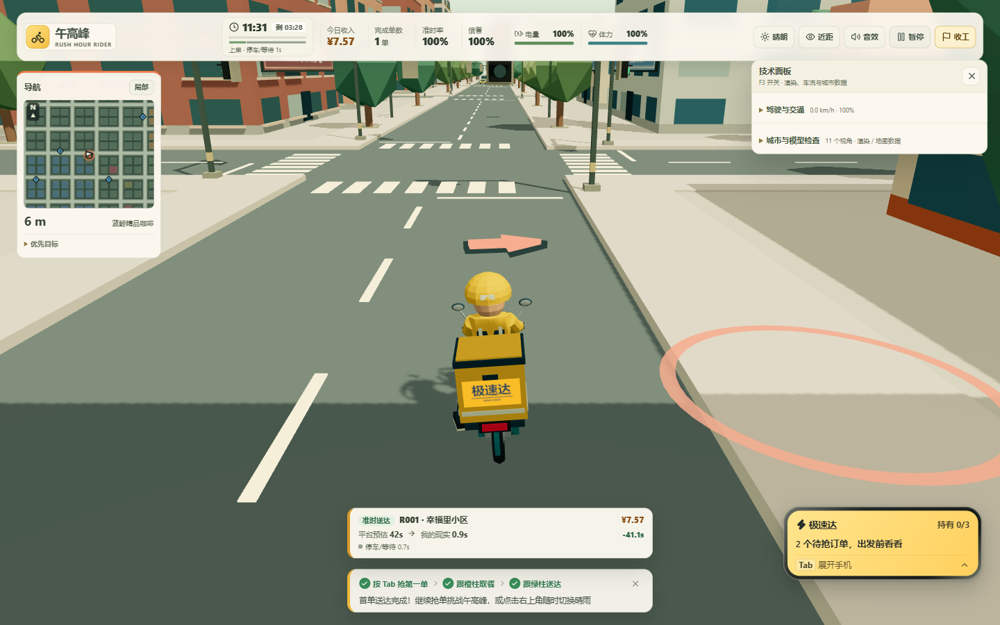

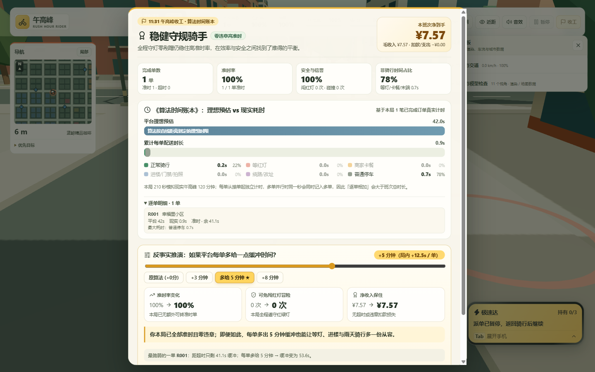

## 2026-11-23 · Day 4 雨天车灯与大堂事件（赛前 6 天打磨）

**完成内容**：
- 修复雨天车头灯白斑：移除 3D 光锥（加色混合在雨夜形成大片白斑的根因），改为柔和径向渐变地面光斑 + 灯罩自发光；光斑透明度收敛到 0.13，半径与长度同步缩小。
- `followCamera` 新增极轻微随速 FOV：最高 +2.6°，`prefers-reduced-motion` 下完全禁用；实测 39.5 km/h 时镜头 52→53.8°，松开油门后随速度回落。
- `cbd-elevator-jam` 文案与新触发时机对齐：徽标改为「写字楼大堂 · 星辰科技大厦」，标题「大堂电梯排队」，描述从“到楼下访客登记与电梯口排队”开始；选项改为「排队等电梯 / 走消防楼梯上 6 楼」，不再出现“人已在大堂里”的错位。
- 按用户要求，Qoder Sites v1 部署顺延至 11/27 检查点，本轮不做公网发布。

**验收结果**：`npm run build` 通过（gzip 约 330 KB）；1440×900 165.3 FPS、控制台 0 error/warn；雨天实景白斑消除、地面光斑柔和；FOV 实测 52→53.8°；通过 `?dev=1` 强制触发大堂电梯事件，卡片文案与选项正确；核心闭环冒烟通过。

**截图归档**：

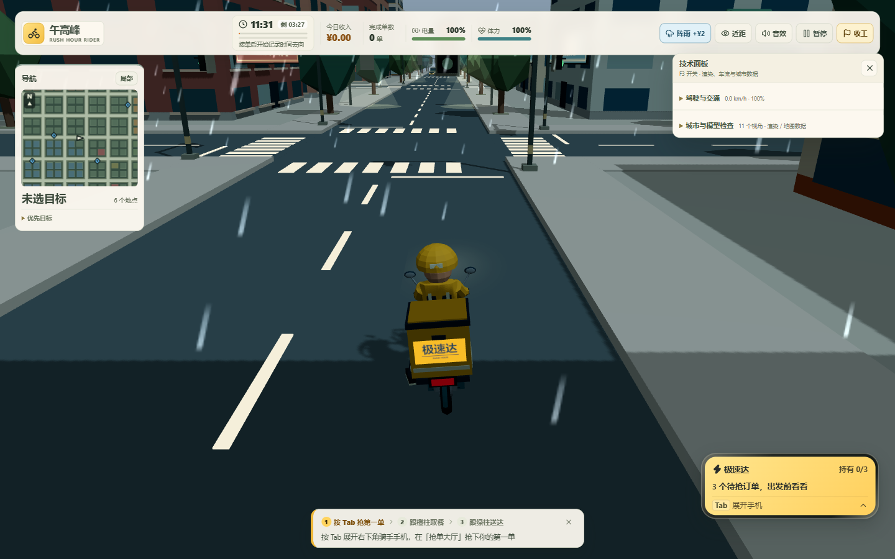

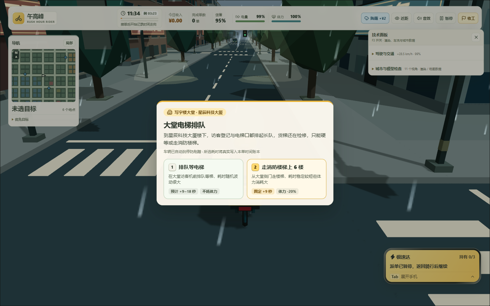

## 2026-11-23 · Day 5 性能/显存与触屏精简操控（赛前 6 天打磨）

**完成内容**：
- 招牌图集重打包：tile 512×128 / 4 列 → **256×64 / 8 列**。65 块招牌的画布由 2048×4096 降到 **2048×1024**，RGBA 显存约 32MB→8MB（含 mipmap 42.7→10.7MB）；8–25m 视距下「沙县小吃 / 阳光小区」等中文招牌仍清晰。
- 阴影按 **30Hz** 节流更新（骑行/标题/模型演示），移动影子几乎无感延迟但阴影 pass 开销减半；小地图按 **15Hz** 重绘（导航数据本身 10Hz），暂停/静止时不再逐帧光栅化。
- 新增触屏精简操控 `TouchControls`：左下左右转向、右下按住加速/刹车、点「手机」开合骑手手机；引擎新增 `setTouchDrive()` 三轴输入，桌面键盘逻辑不变。首屏在触屏设备隐藏键盘键位图、改为「手机/平板可玩：左下转向、右下加速/刹车」。
- 移动端布局修正：事件结果/催单条从 `top:76px` 调到 `156px`，避开 121–153px 的折行 HUD；触屏右侧按钮整体上移，避开底部骑手手机 peek。

**验收结果**：`npm run build` 通过（gzip 合计约 331.8 KB）；1440×900 165.5 FPS、控制台 0 error/warn；390×844 触屏实测加速 0→11.4 m/s、转向 heading 变化、手机按钮可打开；320/360/390/700 视口首屏 CTA 均可见且无横向溢出；招牌近景截图可读；阴影/小地图/暂停/上下文恢复/核心冒烟全部回归通过。

**截图归档**：

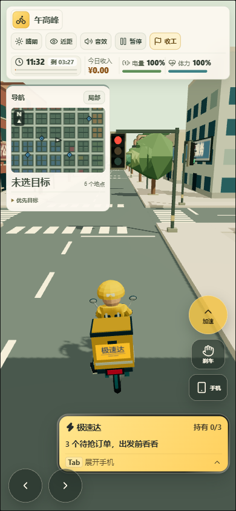

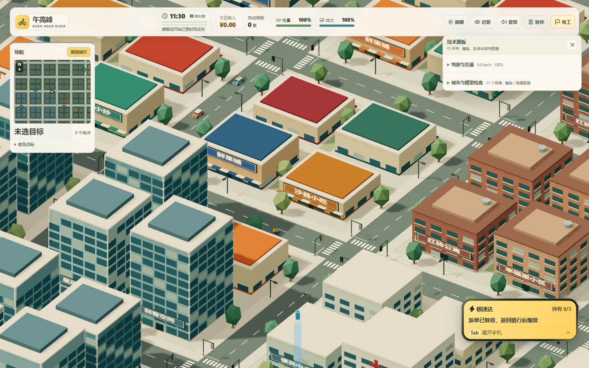
